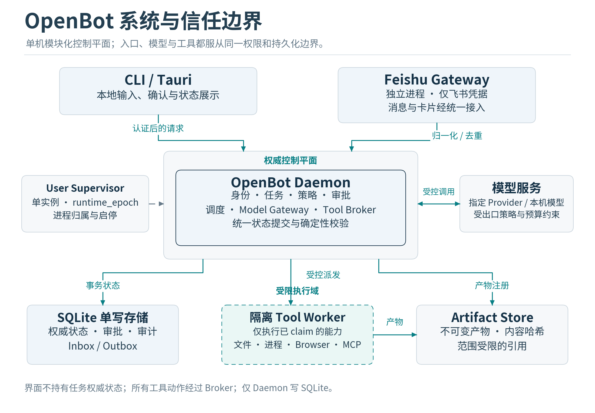
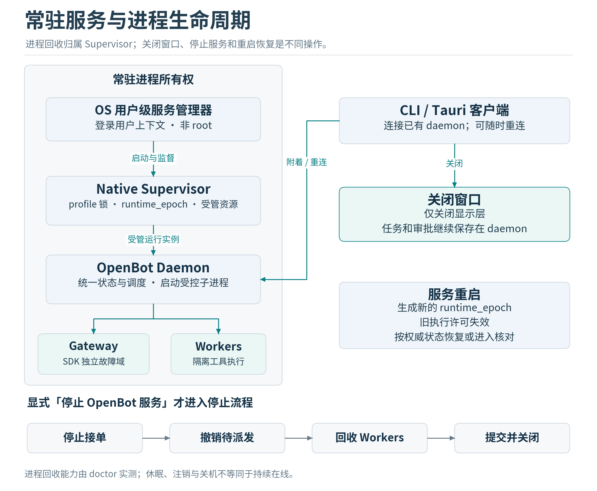

# 系统架构与模块边界

## 总体设计

采用单机模块化架构。控制平面是一个 Python daemon，统一持有任务、审批、调度与 SQLite 写连接。飞书 gateway 为隔离故障的独立进程；工具 worker 按执行域隔离。原生 supervisor 负责进程监督；Tauri UI、CLI 和飞书都是客户端，不持有任务权威状态。

| 组件 | 负责 | 不负责 | 持有的数据 |
|---|---|---|---|
| User Supervisor | 启停、单实例、退出清理、日志通道、升级切换 | 模型决策与业务审批 | profile锁、子进程归属、启动epoch |
| OpenBot Daemon | 身份、任务、策略、审批、调度、状态提交 | 浏览器页面直接渲染或运行任意插件代码 | 唯一 SQLite writer、操作状态 |
| Feishu Gateway | SDK连接、回调转换、消息卡片、重连 | 判断owner权限、直接执行工具 | 仅飞书凭据、短期连接状态 |
| CLI / Tauri | 展示、输入、确认、诊断入口 | 数据库直连、绕过策略、发任意shell | 范围受限的本地会话 |
| Tool Broker | preflight、claim、资源锁、worker分派、结果归档 | 用模型文字推断权限 | operation与dispatch关联 |
| Isolated Worker | 执行已绑定的一个能力或受限批次 | 自发调工具、读取核心库与所有密钥 | 最小输入、专用暂存目录 |
| Model Gateway | 模型协议、能力、出口策略、用量 | 决定工具是否允许 | 选定上下文与对应provider密钥 |
| Artifact Store | 不可变产物、内容哈希、引用与保留 | 作为任意本地路径文件服务器 | 受控对象及metadata |

M1的policy、scheduler、storage、context和broker可以是同一daemon内的清晰模块；只把不可信代码、易阻塞SDK、native parser与浏览器等放到需要的进程边界。v1.2将第三方能力落实为类型化port/adapter，详见12_component_reuse；任何SDK或框架不能接管权威状态、审批和UNKNOWN恢复。

## 物理进程与生命周期

常驻模式是产品默认：用户级 supervisor 启动 daemon，daemon 启动 gateway 和受控 workers。Tauri 启动时连接已有 daemon；关闭窗口仅关闭显示层。托盘“停止 OpenBot 服务”才执行 drain、停止新任务、撤销未开始 dispatch、回收 workers、提交最终状态、关闭数据库。

开发用 ephemeral 模式可让 CLI 启动一次临时 daemon，并在命令结束时关闭；模式必须显式标识，不能与常驻安装混用。服务自动重启后生成新的 runtime_epoch，旧连接与执行许可失效。休眠、用户注销、OS重启分别是不同事件；自动启动不能被解释为后台登录态永远存在。

父进程清理的归属是 supervisor，而不是某个 UI 窗口。macOS 管道 EOF 可以用于正常或崩溃通知，但不能把仅依赖 Python 自救当作强制杀死后的清理保证。Windows 进程用 Job Object；Linux 优先用户级 cgroup，条件不足时进程组只提供协作式回收。所有能力以 doctor 实测结果为准。

## 信任与数据流

信任层级分为用户授权、系统策略、模型建议、外部数据四类。每个身份由接入边界经过校验后产生；模型、卡片 action value、文档内容均不能写入 is_owner 或 permissions。外部数据的摘要、记忆和模型再转述仍保留来源范围，不因“内部模型生成”而升级为授权。

入口数据流为：接入验证、归一化、去重、事务落盘、调度任务。工具数据流为：模型提案、工具合同校验、确定性策略、必要审批、执行前复验、原子 claim、worker、结果提交。任何插件内嵌循环都必须服从同一流程。

通信使用本地 HTTP 加 SSE 作为第一版 transport。只绑定 loopback，校验 Host 和 Origin，不允许任意 CORS；UI WebView 不直接获得广域管理员 token，优先经 Rust command 代理。token 不进入 URL、日志或前端静态资源。启动使用 OS保护的描述文件或继承句柄协商，不采用先找空闲端口再关闭再监听的竞态方式。

在本地同一用户已经被恶意程序完全控制的威胁模型下，普通用户态 token 和 SQLite 文件权限不能提供强安全边界。本项目主要防御模型误操作、恶意输入、第三方工具越权、网络未授权访问与运行故障；更强本机对抗需要独立用户、OS sandbox 或 VM。

## 模块目录

~~~text
openbot/
  apps/cli/
  apps/desktop/                # Tauri 后置接入
  services/core/src/openbot/
    domain/                    # 状态、事件、值对象
    application/               # 用例、调度与恢复
    policy/                    # 身份、能力、审批、出口
    storage/                   # repositories、事务、迁移
    providers/                 # 统一模型网关
    tools/                     # broker、manifest、原语
    artifacts/
    observability/
  services/feishu_gateway/
  native/supervisor/
  contracts/                   # JSON Schema 与 OpenAPI
  db/migrations/
  tests/unit/
  tests/contracts/
  tests/integration/
  tests/security/
  tests/chaos/
  evals/
  docs/adr/
~~~

推荐Python 3.12作为初始验证基线，uv管理分阶段依赖组与锁；Pydantic用于DTO，完整jsonschema验证用于合同与不可信Schema边界，FastAPI提供本地接口；sqlite3或aiosqlite只在storage层使用。Rust与Tauri选用开发时核实过的版本。M0记录核心环境，飞书、浏览器、MCP等在对应任务锁定和资格验证，不在启动阶段一次安装全部候选库。

依赖方向是 adapter 调用 application，application 调用 domain 与 port，基础设施实现 port。domain 不依赖飞书、FastAPI、Tauri或具体模型SDK。禁止在channel回调中创建AgentLoop；禁止UI直接打开SQLite；禁止provider函数执行工具。

## 运行容量与并发

MVP默认每profile一个活动任务；同会话输入按序排队，用户可显式取消或补充当前任务。全局只允许一个GUI动作队列。工作区修改持有workspace写锁；浏览器profile持有独占锁；消息外发按recipient与operation串行。等审批释放计算槽位，但保留操作记录，不长期持有数据库事务或worker进程。

后续可提高只读任务并发，但必须先实现有序多资源锁。资源键至少包括 workspace、browser_profile、desktop_session、external_account。持锁不能跨人工等待；恢复时重新获取并校验资源版本。租约用于发现失联，fence用于拒绝旧写者；对无法识别fence的外部系统，不能声称仅凭租约即可防止重复副作用。

