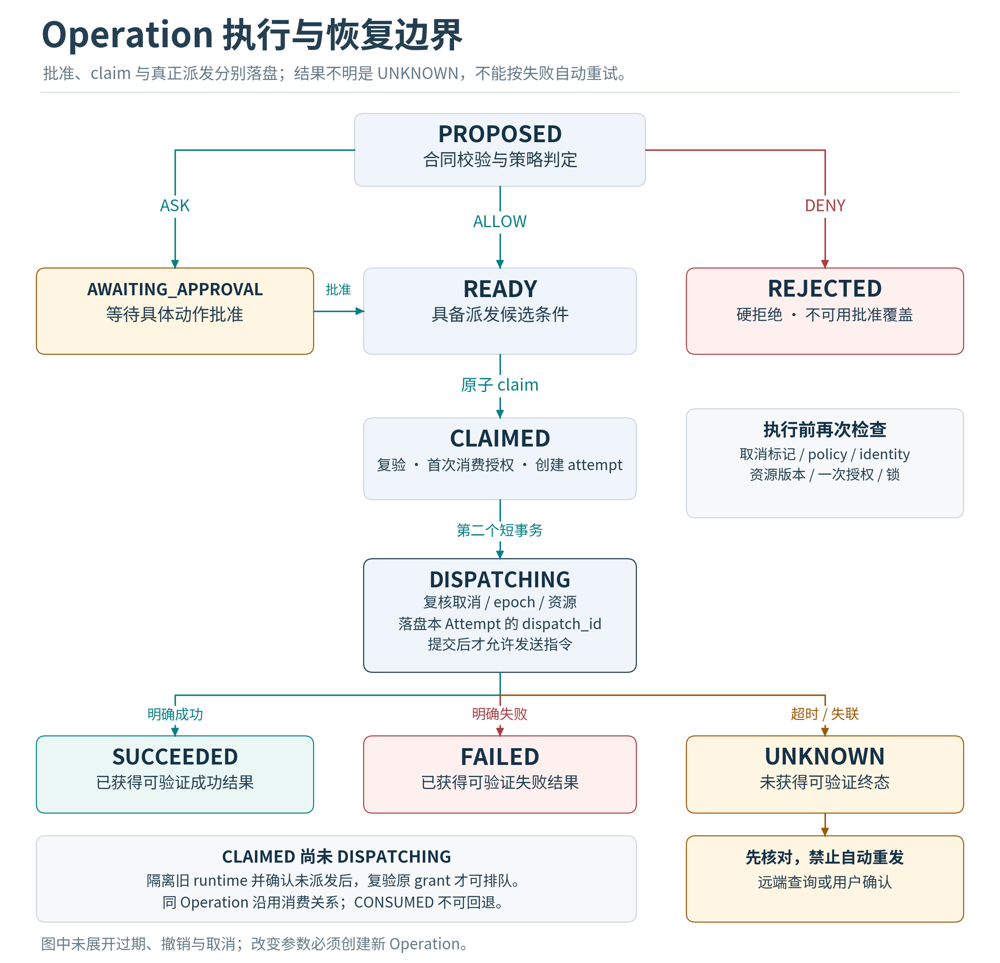

# 任务状态机与崩溃恢复

## 状态与权威数据

MVP采用“事务状态表加只追加审计日志”，不实施完整事件溯源。tasks、operations、approvals是当前状态的权威；events是审计与UI增量流。状态更新、对应事件与通知outbox在同一数据库事务提交。恢复扫描权威表与operation ledger；历史事件回放用于审阅，不直接再次运行工具。

一项Task表达用户目标，一项Operation表达一次具体外部或本地动作，一个Attempt表达该Operation的一次执行尝试。模型调用也要有记录与预算，但它可以在预算内重试生成；不能把“再生成一次提案”与“再执行一次已批准动作”混为一谈。

## Task状态

| 状态 | 进入条件 | 允许的后续 |
|---|---|---|
| QUEUED | 已持久化但未获得调度槽 | RUNNING、PAUSED、CANCELLED |
| RUNNING | 正在规划、校验或执行 | WAITING_APPROVAL、WAITING_INPUT、WAITING_RESOURCE、RECONCILING、PAUSED、SUCCEEDED、PARTIAL、FAILED、CANCELLED |
| WAITING_APPROVAL | 存在明确待批准Operation | QUEUED、PAUSED、FAILED、CANCELLED |
| WAITING_INPUT | 缺少必要参数或需用户处理登录 | QUEUED、PAUSED、FAILED、CANCELLED |
| WAITING_RESOURCE | 缺少网络、模型、沙箱、权限或资源锁 | QUEUED、PAUSED、FAILED、CANCELLED |
| RECONCILING | 有结果不明或需核对的动作 | QUEUED、PARTIAL、FAILED、CANCELLED；有未解决UNKNOWN时不能直接标成功 |
| PAUSED | 用户暂停、预算耗尽、升级维护 | QUEUED、CANCELLED；恢复前重新核对前置条件 |
| SUCCEEDED | 验证器确认目标产物与要求完成 | 终态；继续请求产生新Task |
| PARTIAL | 部分产物可用，仍有明确未完成内容 | 终态；记录哪些动作已完成 |
| FAILED | 无法继续且有明确错误原因 | 终态；重试通过新Task或受控恢复命令 |
| CANCELLED | 后续执行已停止且没有未核对的外部动作 | 终态；不表示过去的外部效果已回滚 |

取消通过cancel_requested_at和cancel_revision持久化传播。任务收到取消请求后立即停止派发新动作；若存在DISPATCHING或UNKNOWN，则显示“正在停止或核对”，继续停留在RECONCILING，不能提前宣告所有效果已经取消。

## Operation状态与原子边界

PROPOSED经过schema和policy检查后进入READY、AWAITING_APPROVAL或REJECTED。审批成功仅进入READY。Broker在同一个事务里检查任务、身份、policy、grant和资源版本，消费批准，创建attempt，并把Operation改为CLAIMED。

在向执行器发送任何可能触发外部效果的指令之前，必须以第二个短事务复核取消、epoch和资源仍有效，再持久化DISPATCHING与该Attempt的固定dispatch_id。worker/broker保存dispatch接收ledger。明确结果落盘后进入SUCCEEDED或FAILED。任何“发出指令后没有获得可验证终态”的场景进入UNKNOWN，而不是根据超时推断失败。

CLAIMED但未进入DISPATCHING的操作，在确认旧runtime已被隔离且没有派发记录后可重新排队。DISPATCHING及其之后发生故障，必须按工具类别处理。拒绝、过期、撤销、取消都是终止当前Operation；重新审批或改变参数会创建新的Operation。Approval一旦CONSUMED永不退回APPROVED；同Operation的安全重试沿用既有消费关系，不二次消费，但每次仍复验原授权期限、policy、身份、取消和资源。任何条件变化都新建Operation。

## 工具重试分类

| retry_class | 例子 | 崩溃后的处理 |
|---|---|---|
| SAFE_READ | 读取不可变artifact，查询允许范围文件 | 可重试，但记录读取版本；文件已变更时更新观察 |
| IDEMPOTENT_WRITE | 按旧文件hash应用指定patch、写内容寻址对象 | 用前置条件、目标hash与operation_id核对，确认未完成才再执行 |
| PROVIDER_IDEMPOTENT | 外部API明确支持幂等键和有效期 | 使用原幂等键，在provider约定窗口内查询或重试；过窗转UNKNOWN |
| RECONCILE_ONLY | 网页点击发送、GUI提交、不具备去重语义的消息API | 查询远端结果或请求用户核对；禁止自动再次提交 |
| NON_RETRYABLE | 不支持核对的高风险不可逆动作 | 默认不开放；手工处理后记录结果和证据 |

重试策略来自本地经过审核的tool manifest，不能采信第三方MCP的readOnlyHint或idempotentHint作为授权依据。[S05]

## 恢复算法

1. 获取profile独占OS锁，创建runtime_epoch，验证schema与磁盘状态；无法确认唯一活动runtime时拒绝执行模式。
2. 询问supervisor，停止或隔离前一epoch仍存活的workers。无法证明旧执行器已失效的资源进入WAITING_RESOURCE。
3. 扫描非终态tasks、未终态operations、未发送outbox与未处理inbox，按事务状态恢复，不重新运行历史事件。
4. 过期待审批请求标EXPIRED；已批准但policy、workspace或identity变化则REVOKED；不能保证旧卡片一直有效。
5. CLAIMED操作满足安全条件时可回到READY；DISPATCHING操作转UNKNOWN并按retry_class核对。
6. 对明确可重试的动作创建新的attempt与新的dispatch_id，保留原operation_id与provider_idempotency_key；同一attempt的消息重传才复用dispatch_id。不可重试动作进入RECONCILING。
7. 向用户发送恢复摘要，明确已完成、待审批、结果不明和仍不可用的能力。

## 故障注入表

| 崩溃点 | 已落盘内容 | 恢复应有结果 |
|---|---|---|
| 入站事务提交前 | 无inbox | 不ACK成功；等待平台重推或用户重试 |
| 入站提交后ACK前 | inbox与task | 同事件再次到达被去重；只保留一个逻辑Task |
| 批准提交后卡片响应前 | APPROVED与READY | UI可能提示超时；重复查询显示真实状态，不能重复授权 |
| claim提交后dispatch前 | CLAIMED | 旧worker已隔离后可安全恢复；不消耗第二次批准 |
| DISPATCHING提交后发包前 | DISPATCHING | 仍按可能已执行处理；安全优先，必要时进入UNKNOWN |
| 外部成功后本地落盘前 | DISPATCHING | 远端查询或人工核对；禁止直接再发 |
| outbox远端发送后本地标记前 | IN_FLIGHT | 按远端幂等能力核对；不能保证恰好一次通知 |
| 结果写入后UI更新前 | SUCCEEDED与outbox | UI重新订阅事件或读取快照恢复正确显示 |
| 磁盘满或writer故障 | 提交失败 | 停止新派发；不以内存成功代替durable成功 |

## 并发与时钟

MVP单活动Task仍需要处理回调、取消、心跳与outbox并发。所有状态转换检查expected_version并递增version；每个attempt带runtime_epoch与fencing_token。Broker只接受当前epoch和未消费dispatch。外部API不支持fence时，不能仅靠数据库租约让第二个worker接管同一动作。

持久时间使用UTC毫秒；单进程超时使用单调时钟。系统时钟倒退、休眠恢复和时钟大幅跃迁触发重新检查。跨重启无法可靠证明未过期的敏感授权应失效重审。不要只比较客户端传入的时间戳。

## 验证目标完成

模型的final文本只能申请完成。OutcomeVerifier必须核对约定产物、必要测试结果、未解决审批、UNKNOWN动作和预算记录。诊断任务至少产出来源引用；补丁任务至少产出diff与原文件hash；测试任务至少产出命令、快照、退出码与日志摘要。只完成部分要求时为PARTIAL，并清楚告知遗漏。

来源引用只能取服务端在本轮记录的效果（同一 run 的 Operation/Artifact），模型文本既不能生成也不能自证引用；Task 不得引用自己作为证据。本轮没有记录任何效果时，运行只能以 CHAT 类别提交对话产物，不声称外部副作用，因此也不需要来源引用。这样纯对话不会被误判为已验证的诊断，但已产生的副作用也不会被用来为后续轮次背书。

## 全局终态与恢复守卫

所有进入CANCELLED的边都要求不存在DISPATCHING或UNKNOWN动作；仍有不确定效果则停在RECONCILING。普通resume只能恢复可恢复任务，不能跳过核对使RECONCILING直接进入运行。只有恢复器确认所有相关未知结果已按工具语义解决，才允许重新QUEUED。

UNKNOWN期间相关workspace、browser profile或external_account持有持久quarantine锁；新Task或新Operation不能借更换ID绕过它重复同类写动作。无关只读工作可继续。人工核对通过专用接口提交证据、expected_operation_version与明确结论；系统区分PROVIDER_VERIFIED和USER_ATTESTED，不能把模型输出当核对证据，也不把人工确认伪装成远端API证明。
