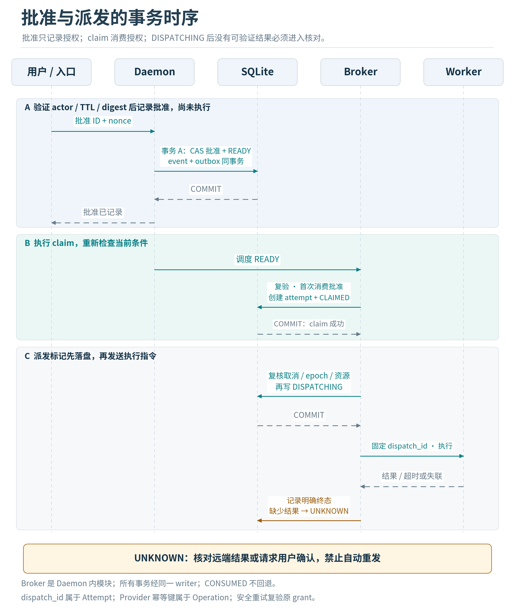

# 权限模型与审批协议

## 保护目标与默认拒绝

需要保护的资产包括工作区文件、用户凭据、浏览器登录态、外部账户、审批授权、运行配置与审计记录。输入中的网页、README、Issue、邮件、MCP描述、工具输出和模型回复都不能赋予权限。策略由代码、受控配置与已认证用户的具体授权组成。

风险不能仅由“工具名属于L0还是L2”确定。一次read可能泄露秘密，一次浏览器导航可能向恶意域名携带信息，一次pytest可能执行任意仓库代码。因此Decision取决于actor、resource、action、data_class、destination、execution_backend与当前授权。

| 决策 | 适用例子 | 限制 |
|---|---|---|
| ALLOW | 范围内普通文件读取、只生成本地草稿、读取脱敏状态 | 仍记录来源、边界与预算 |
| ASK | 应用补丁、隔离代码执行、上传文件、具体外发 | 绑定精确操作和资源版本 |
| DENY | 未配对身份、敏感路径、禁用能力、未知工具、禁止出口 | 远程点击批准不能覆盖硬拒绝 |
| REQUIRE_LOCAL | 更改安全策略、增加工作区、配置凭据 | 需本地已认证设置流程 |

审批频率由用户创建的有限capability grant减少，而不是“信任整个聊天窗口”。MVP禁止TRUSTED_HOST_EXECUTION，包括审核过的第三方MCP程序。若未来增加可信宿主执行，必须独立ADR和本地启用，不作为隔离失败的兜底。MVP可以配置允许的工作区读取；对任意程序执行、第三方发送和浏览器写动作默认一次一审。后续限时、限目录、限金额或限工具的grant必须有独立数据模型。

## 身份与会话绑定

飞书身份键为tenant_id、app_id、external_user_id的组合；chat_id不是用户身份。channel_instance与profile绑定；callback.operator经过验证后映射principal_id。禁止从action.value读取“我是owner”、role或批准者姓名作为权威。

配对流程必须由本地登录用户发起，创建单次随机挑战，设置短TTL和尝试次数；飞书回传只能形成待确认配对。本地显示tenant、app、用户标识并确认后才成为owner。不能让远端第一个发送消息的人自动获得owner权限。二维码只是挑战的显示方式，不是身份本身。

MVP不启用群聊执行；若后续开启群聊，必须明确谁可触发任务、谁可看到结果、谁可审批以及哪些结果只私聊返回。回到原任务owner的状态通知属于已授权反馈，向第三方发送内容则是独立敏感动作。

## 不可变提案与审批绑定

提案包含profile_id、principal_id、session_id、task_id、operation_id、workspace_id、tool_name、tool_version、tool_manifest_digest、canonical_args、resource_snapshot、data_class、destination、policy_version、identity_epoch、expires_at和approval_nonce_hash。原nonce仅保存在受保护challenge store，不作为完整内部提案的普通可导出字段。

使用约定的规范化JSON方案构造binding，计算SHA-256。JSON字段排序、浮点数、Unicode和无效值必须明确约束；采用RFC8785实现与golden vectors，不能把不同语言的默认JSON序列化当作跨语言规范。[S06] 本地Python为hash的唯一权威，UI只展示server提供的digest。浮点高风险参数优先使用整数最小单位或十进制字符串。

v1.2选择经测试的rfc8785库；JCS键按UTF-16 code units排序，而不是Python默认Unicode码位序。输入先拒绝重复键、非法Unicode、NaN/Infinity和不支持的数值域；不把任意大整数强行转float。Pydantic的frozen是浅层保护，嵌套dict仍可能变化，因此服务端必须生成并保存权威canonical bytes/摘要，执行前从权威记录复核，不依赖可变DTO引用。[R01][R02]

审批卡片只携带不透明approval_id、nonce与显示用短hash；完整提案保存在本地。对外GET审批返回独立ApprovalPreview DTO而不是ToolProposal原件；预览被过滤不改变原binding_hash。本地预览同样不得展示SECRET值，只展示secret handle和用途。敏感命令和diff在飞书显示经过数据策略过滤的足够预览；如果不能安全展示完整影响范围，要求本地审批，不能让用户盲批截断内容。

## 两阶段检查与执行claim

第一次检查发生在用户点击时：验证真实actor、profile、所属task、card上下文、nonce、PENDING状态、TTL、policy版本、identity epoch、任务未取消和proposal digest。以CAS更新APPROVED，追加审计、使Operation READY，并写outbox；一次事务完成。

第二次检查发生在Broker派发时：重新读取授权、task取消标记、当前policy和资源版本，首次执行验证未使用且未过期；获取资源锁；原子消费approval、创建attempt并将Operation改CLAIMED。仅恢复器批准的同Operation安全重试可以复用匹配的CONSUMED记录，不能复用给其他Operation，且仍须复验原授权的期限和其他全部条件。approval的CONSUMED表示已被用于该Operation，不等于外部动作已经成功。

执行前置条件包括文件old_sha256、工具manifest digest、隔离后端、浏览器页面revision与目标frame、收件账户和内容hash。批准后发生任何影响语义的变化，旧Operation失效，重新生成提案；不得悄悄替换参数继续执行。

批准的过期时间针对开始执行。已经开始的动作不能通过“授权过期”被假装回滚；撤销会阻止后续新派发并尽力停止仍可停止的worker。审批和取消之间的顺序由同一writer事务确定。CLAIMED到DISPATCHING的事务必须再次检查取消；在DISPATCHING提交前已取消则不开始派发。DISPATCHING提交之后收到的取消只能尽力停止在途动作并阻止下一步，UI必须如实说明。

## 本地能力授权

Tool Broker生成短期、一次使用的dispatch token，绑定operation、attempt、executor、args hash、resource版本、runtime_epoch、deadline与允许的网络/文件范围。worker只能请求这一dispatch；不能用同一token执行新的工具。token通过继承pipe或受保护IPC传输，不写argv或日志。

Python控制进程可以保存业务策略；不可信Shell、MCP、浏览器插件不能加载进它的地址空间。Gateway只拿飞书凭据，ModelGateway只拿被选Provider密钥，执行器按用途获得单个secret handle。禁止直接继承父进程全部env或把宿主HOME挂进沙箱。

## 代码执行与文件边界

任意解释器、构建工具、测试命令、包管理器、Git钩子都视为代码执行。传argv、防shell字符串注入和限制cwd仍然有价值，但它们不是文件系统或网络隔离。[S10] 默认执行后端使用受控容器：非root、drop capabilities、无privileged、无Docker socket、只读基础层、临时可写目录、资源限制、默认禁止网络、只读输入快照和单独输出区。

默认不挂载用户原目录作为容器可写workspace。由artifact broker导出大小受限的产物，校验symlink、路径、类型与hash后注册。构建依赖在锁定镜像或明确批准的准备阶段获取；测试运行时不自动联网安装。

宿主文件ACI需要路径对象和OS句柄级防护；path.resolve与字符串前缀检查仅作为初筛。拒绝工作区外、设备路径、UNC与不受支持reparse point、Windows ADS、隐藏敏感配置等；创建文件核验父目录、使用临时文件原子替换、检查旧hash；必要时仅允许受管工作树。恶意同用户进程可持续改变目录时，不能宣称普通路径校验能完全防住，必须依赖隔离后端。

## 网络与隐私模式

| 模式 | 模型出口 | 飞书 | Browser/MCP外网 | 用途 |
|---|---|---|---|---|
| CONNECTED | 指定允许的provider | 可启用 | 逐域名与能力控制 | 正常远程助手 |
| LOCAL_MODEL | 仅已核实的本机模型服务 | 可启用 | 仍单独授权 | 模型数据本地处理 |
| OFFLINE | 本机模型或mock | 禁用 | 禁用 | 无网络任务 |

LOCAL_MODEL不等于数据永不离机：飞书回复、日志导出和浏览器仍可能外发。OFFLINE须在连接构建时拒绝外部endpoint，并用网络边界验证，不仅靠“模型地址写localhost”。容器loopback并不等于宿主loopback，endpoint解析必须按实际网络命名空间检查。

将数据分类为PUBLIC、WORKSPACE、SENSITIVE、SECRET。SECRET默认不读取、不进入模型；SENSITIVE不得自动发云或进入飞书卡片。每次ModelGateway发送上下文也是数据出口，必须受policy控制。正则脱敏只是补充手段，不能保证识别所有秘密。

来源/指令权威与数据敏感级别是不同维度：公开网页可以是PUBLIC但仍无权赋予权限；本地可信配置可能包含SECRET。摘要继承实际输入的数据限制和来源，不继承新的下指令权。导入文件自称已审查或PUBLIC不是降级依据。

## MCP与间接注入

pinning覆盖server包digest、运行命令、环境、transport、完整tool definition、inputSchema/outputSchema/annotations和授权范围。启动重新计算；收到list_changed先隔离相关工具，再比对差异，变更需重新审查。固定版本不代表永久安全，必须有安全更新流程。[S04][S05]

工具输出做结构验证、大小限制和来源标记，但不宣称“清洗后可信”。未知MCP server默认不执行；MVP禁用远端sampling、自动安装和隐式权限升级。若集成库内嵌agent loop且无法逐动作经过Broker，则只使用其只读能力或推迟接入。

## 审批challenge与渠道权限

创建审批时生成随机nonce，仅将approval_nonce_hash纳入不可变binding；原nonce保存在受保护的challenge store，普通日志与SSE不包含它。飞书仅向允许的owner卡片携带当前nonce；本地已认证、具备approval.challenge范围的客户端通过POST /v1/approvals/{id}/challenge取得当前有效nonce。获取challenge不等于批准，接口仅适用于PENDING、未过期且属于调用方的审批。

重启后从受保护store恢复同一nonce；无法恢复时返回CHALLENGE_UNAVAILABLE并撤销旧审批，重新生成Operation，而不是修改原hash或绕过nonce。gateway token不能调用本地challenge端点。ApprovalPreview返回decision_surface为REMOTE_ALLOWED或LOCAL_REQUIRED；任何敏感内容被省略且影响用户判断时必须LOCAL_REQUIRED，服务端决策接口复核调用渠道。

Task请求中的network_mode和Browser请求中的allowed_origins只能收窄权限。有效权限等于profile策略、principal grant、工作区策略和本次请求范围的交集。请求CONNECTED不能取消全局OFFLINE，请求allowed_origins也不能自行新增域名。
