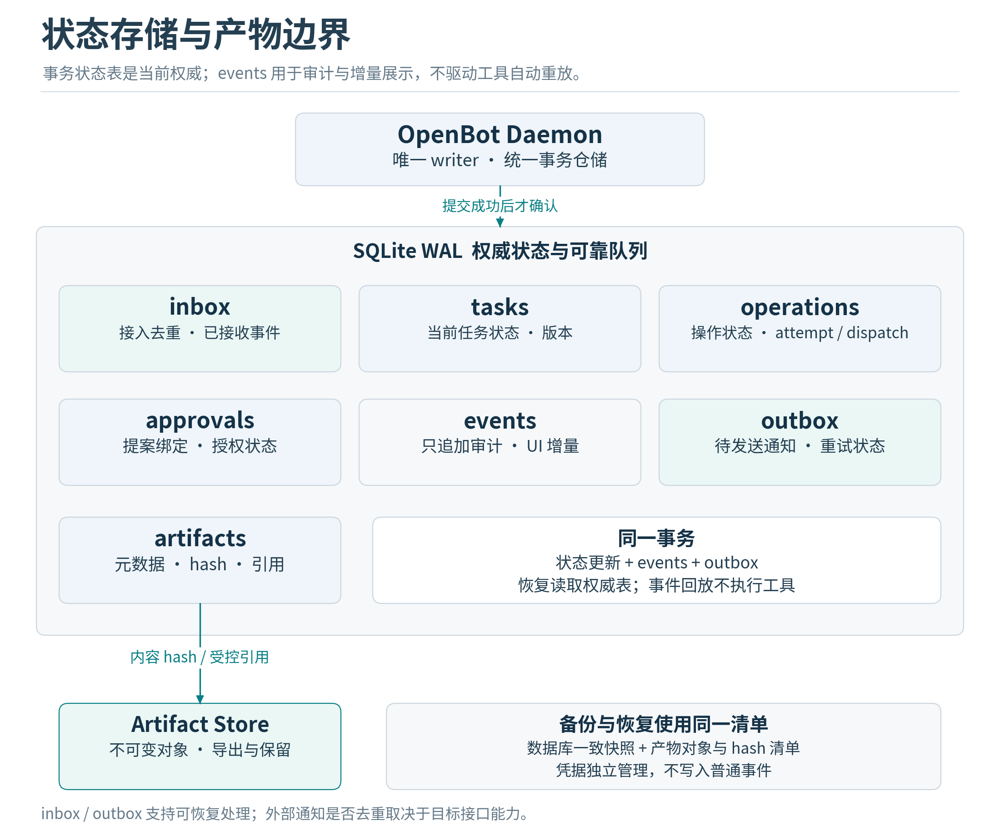

# 数据模型与接口合同

v1.2保留本章23张核心表和14个本地API操作。新增components清单是构建/验证元数据，不在本轮伪造数据库迁移或修改旧授权记录。API采用FastAPI/Pydantic适配，事件流可封装sse-starlette；框架仅承担传输和DTO，所有身份、审批、恢复与事务语义仍由application层执行。

合同验证使用选定的jsonschema Draft 2020-12实现与本地referencing.Registry，显式配置需要的format checker；不自动获取网络ref。Pydantic生成Schema和现有contracts双向做黄金样例核对，差异先修合同，不能让两个模型独立演进。SDK与校验库升级属于合同回归触发条件。[R02]

## 本地存储原则

每个profile使用独立目录、独立SQLite库和独立token；MVP不在一个数据库中模拟企业多租户。状态表是权威，审计日志是事实记录。对象ID用不可预测ID；事件排序使用数据库seq而不依赖UUID的字典顺序。所有对外ID在owner/profile范围内检查，不因知道ID就获得访问权限。

单writer通过专用执行线程或协程队列串行处理短事务；读连接为query_only并限制查询时间。事务内不await模型、网络、进程、人工审批或另一个写事务。writer队列必须有界，并给审批、取消与入站事务独立配额；“单writer”不意味着可以无限排队。

默认先用sqlite3与专用writer线程，aiosqlite作为可选适配；异步驱动的串行队列不能替代应用层事务归属。使用aiosqlite时，await数据库驱动是允许的，但整个业务事务必须由一个writer命令独占，不能让其他协程的SQL插入其中。不能用通用PriorityQueue名字代替配额、公平性、取消和过期命令丢弃测试，也不把“80行迁移器/150行writer”作为设计目标。

WriterCommand携带稳定请求ID和deadline；调用者取消等待不证明底层线程没有提交。实际COMMIT后才能形成成功ACK，等待结果不明时按请求ID与权威状态重查，不自动重放。优先队列为审批、取消、执行结果与停止保留容量，并声明普通任务的公平性；锁等待只是总deadline的一部分。[R19]

在线备份的快照形成与复制阶段要pin住相关Artifact引用，防止GC删除快照需要的文件。备份清单保存对象hash、版本与secret_ref，真实秘密仍由受保护存储管理；恢复后秘密引用不可用时进入配置流程，恢复的UNKNOWN继续核对而不重放。

控制数据库采用WAL、synchronous=FULL、foreign_keys=ON。WAL允许读写并发，但仍可能返回BUSY，且不适合把数据库放在网络文件系统上。[S03] busy_timeout必须小于调用路径剩余deadline，不能让回调被固定5秒等待拖过3秒。启动校验实际SQLite版本和PRAGMA结果；不只检查配置文件写了什么。

## 逻辑表划分

| 表或对象 | 核心字段与用途 | 约束 |
|---|---|---|
| schema_migrations | version、checksum、applied_at | 顺序迁移；checksum不匹配停止写入 |
| profile_config | profile_id、schema_version、policy_version、identity_epoch | 一个数据库一个profile |
| principals | principal_id、role、status、revoked_at | MVP只有一个活动owner |
| channel_accounts | account_id、channel、tenant_id、app_id、secret_ref | 凭据仅存引用 |
| channel_identities | identity_id、account_id、external_user_id、principal_id | account和外部user联合唯一 |
| workspaces | workspace_id、root_ref、generation、status | 根目录变更提升generation并撤销旧授权 |
| sessions | session_id、owner_id、workspace_id、status、version | 会话归属稳定，不归WebSocket |
| tasks | goal、state、version、budget_id、cancel_requested_at、checkpoint | 状态转换CAS；明确终态 |
| inbox | source_scope、external_event_id、payload_hash、received_at、status | source与外部event联合唯一 |
| events | seq、event_id、aggregate_id、event_type、schema_version、payload | 与状态同事务追加；不作为重执行指令 |
| messages | task_id、turn、provider_call_id、role、content_ref、provenance | 工具调用与返回一一关联 |
| operations | immutable proposal、binding_hash、retry_class、state、provider_idempotency_key | proposal不可变；state/version单独变化 |
| approvals | operation_id、actor_scope、nonce_hash、expires_at、status | 一个Operation一个批准对象；一次消费 |
| operation_attempts | attempt_no、runtime_epoch、fence、dispatch_id、status、receipt | 同一dispatch唯一，历史尝试不覆盖 |
| outbox | semantic_key、target、payload_ref、revision、state、attempts、deadline | 处理乱序、合并、重启和结果不明 |
| artifacts | object_id、sha256、mime、bytes、classification、expires_at | 不返回任意宿主路径，不可变 |
| artifact_refs | object_id、owner/task/session、purpose | 防跨任务越权与误删除 |
| budgets与reservations | 限额、已花费、预留、来源 | 调用前预留，结果后结算 |
| resource_leases | resource_key、holder、epoch、fence、expires_at | 不代表外部系统支持fence |
| tool_registry | tool_id、version、manifest_digest、package_digest、status | 修改定义后隔离，不静默升级 |
| runtime_instances | runtime_epoch、boot_id、started_at、heartbeat | 记录实例和恢复边界 |
| policy_revisions | version、digest、effective_at、rules | 新版本生效使不兼容旧授权失效 |

长期记忆、embedding与schedule表放在后续migration，不为“将来可能”提前实现复杂检索。若原型已有旧11表，不能覆盖数据库；需要显式映射与迁移任务。

## 必须具备的事务单元

T1 收到消息：插入inbox，分配session/task，追加TaskQueued事件，生成状态通知outbox；联合去重失败则返回已有Task。

T2 生成提案：插入不可变Operation，记录PolicyDecision；需要审批时插入Approval、切Task为WAITING_APPROVAL并写outbox。

T3 用户批准：校验身份与binding，CAS修改Approval和Operation、追加事件、写状态outbox。任何一步失败全部回滚。

T4 派发claim：复验当前policy、cancel、TTL和资源，消费Approval，创建Attempt，更新Operation为CLAIMED。同Operation安全重试复用已消费授权而不将其复活。CLAIMED到DISPATCHING在新的短事务里复核取消、epoch与资源，再持久化该Attempt的dispatch_id后才能调用外部执行器。

T5 完成动作：写结果receipt与artifact引用，更新Attempt和Operation、结算预算、推进Task、追加事件与outbox。

T6 取消：提升cancel_revision，终止未开始Operation并撤销相关Approval，记录已执行和待核对动作，生成反馈。不能简单级联删除Task。

## 公共本地API

完整结构在contracts/openapi.yaml。所有接口均受本地认证、profile绑定和大小限制；除健康探测的最小响应外不提供匿名数据。

| 方法与路径 | 用途 | 关键语义 |
|---|---|---|
| GET /v1/health | daemon readiness、version与能力摘要 | 不暴露token、路径或secret |
| POST /v1/tasks | 创建Task | 必须Idempotency-Key；同key不同payload返回409 |
| GET /v1/tasks/{task_id} | 状态快照 | 返回version与最后event_seq |
| POST /v1/tasks/{task_id}/cancel | 请求取消 | 幂等；返回已请求或已终态，不能伪称外部回滚 |
| POST /v1/tasks/{task_id}/resume | 恢复可恢复任务 | expected_version；重新检查预算、资源和授权 |
| GET /v1/events | SSE事件流 | after_seq或Last-Event-ID；断点恢复，保留期外返回410并要求重取snapshot |
| GET /v1/approvals/{approval_id} | 不可变提案预览 | 过滤敏感内容；显示hash和实际执行范围 |
| POST /v1/approvals/{approval_id}/decisions | 批准或拒绝 | caller身份由认证生成；body没有actor_id或role |
| GET /v1/artifacts/{artifact_id} | 下载获授权产物 | Range有上限；固定Content-Disposition，不内联执行HTML |
| GET /v1/capabilities | 可用工具、隔离后端和平台限制 | 同时返回不可用原因 |
| POST /v1/reconciliations/{operation_id} | 结果核对 | 需证据；不能以“忽略”自动重复发送 |

Gateway内部接口单独授权，不能复用管理员端点。模型只使用model-tool-call.schema.json提交tool_name与args；服务端再生成包含身份、策略与绑定内容的ToolProposal。模型不能调用审批API、配置API、凭据API或reconciliation接口。

错误统一为code、message、retryable、trace_id、details。示例代码：AUTH_REQUIRED、OWNER_REVOKED、POLICY_DENIED、APPROVAL_EXPIRED、BINDING_MISMATCH、RESOURCE_CHANGED、VERSION_CONFLICT、OUTCOME_UNKNOWN、BUDGET_EXHAUSTED、CAPABILITY_UNAVAILABLE、STORAGE_UNAVAILABLE、SCHEMA_UNSUPPORTED。

## 工具与事件合同

ToolProposal是内部合同，带schema_version、operation_id、task_id、tool名称与版本、args、资源snapshot、数据级别、retry_class和policy_version。实际用于审批的binding由服务端补齐身份与nonce；LLM不提供这些权威字段。

RuntimeEvent只包含给客户端公开的事件、trace_id和seq。Token streaming可以是临时展示事件；TaskQueued、ApprovalRequested、OperationStarted、OperationFinished、OutcomeUnknown和TaskFinished等业务事件必须持久。SSE消费者按seq去重，UI先读snapshot再续接事件，避免重连丢状态。

模型工具参数与外部附件禁止超大内嵌。默认文本预览8KiB、完整单产物20MiB、单任务总产物100MiB、单次上传上限与压缩包解压比率都应配置化。这些是初始产品限额，不是安全证明；大文件处理必须分块或显式提高限额。

## 备份与数据寿命

活跃SQLite使用在线backup API或停止写入后的完整一致性备份，不只复制.db而遗漏WAL。备份包含DB、artifact manifest、必要配置与版本信息；凭据不进入普通备份，恢复时重新绑定或使用独立加密备份流程。

建议默认事件保留30天、普通工具日志14天、截图24小时；用户可配置，但未完成Task和正在被审批引用的产物不能清理。保留期只是建议产品值。审计清理采用显式purge与tombstone，避免ON DELETE CASCADE悄悄抹除授权证据。

本地审计可帮助排障，不是防同一OS用户篡改的合规级审计。未来企业审计需外部只追加存储或远程签名锚定，不能靠本地hash链声称不可篡改。

## 文件与数据库的提交缝隙

Artifact先写临时文件、flush与fsync、计算hash并原子rename，再在事务中登记metadata和引用。恢复时扫描临时文件、无主对象与缺失对象，缺失时显示不可用而不是伪造成功。多文件patch set保存每文件前后hash与应用阶段；跨多个文件不存在通用SQLite式原子提交，失败时暂停、核对已改文件并按前置条件补偿。不得覆盖用户在此期间的其他修改。

## 安全预览与核对接口补充

GET /v1/approvals/{approval_id}返回approval-preview.schema.json；完整ToolProposal仅供可信控制平面使用。POST /v1/approvals/{approval_id}/challenge为本地owner提供受限challenge恢复通道，不向SSE广播nonce。

GET /v1/operations/{operation_id}返回受权限过滤的OperationSnapshot，包括Operation.version、state、binding_hash、attempt摘要、结果引用与允许核对选项。Reconciliation中的expected_version必须匹配Operation.version，不得使用Task.version。KEEP_UNKNOWN可以只留说明，无需新artifact；确认成功或确认无副作用失败需要已授权且来源可追踪的证据。结果核对不接受任意retry按钮，后续重试仍由恢复器按原授权与工具语义判断。

本地用户可通过POST /v1/artifacts/import导入任务附件或核对证据；仅接收受限multipart文件内容，禁止传任意宿主文件路径。服务端检查大小、类型、hash、归属和分类，不执行内容。人工结论记录实际来源和确认人；普通用户一句“success”、模型文本或未验证的远程工具字段不能直接改写终态。

SSE若同时提供after_seq与Last-Event-ID，数值必须相等，否则返回400；服务端不猜测冲突游标。
