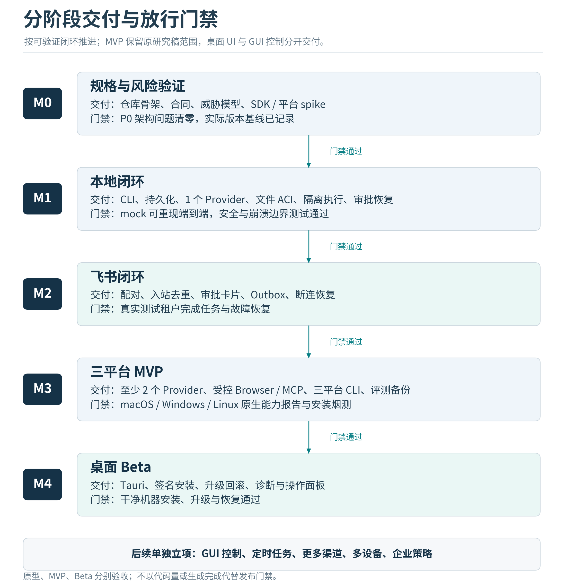

# 项目计划与AI编码交接

v1.2任务总数为96：原OB-001至088保留，新增089至096。M0/M1/M2/M3/M4/P2分别为13/37/11/25/4/6项。组件复用改变实现方式、准入与验收，不减少授权/恢复责任；逐项差异见tasks/REVISION_v1_2.md和tasks/revision_delta.json。

## 项目交付方式

把本包放入新仓库，先让Codex或Claude Code读取README、AGENTS、当前阶段文档和指定任务卡。模型可以协助编码、运行测试和整理差异，产品范围、安全决策、真实服务凭据、签名发布与最终验收仍需有明确的责任人。

tasks/backlog.json是任务事实源，TASKS.md是可读任务手册。任务ID稳定；实现过程中按实际情况新增子任务，不随意重编号。所有任务初始为TODO，不能因本包已经写出接口或SQL就标记实现完成。

## 里程碑与退出条件

| 阶段 | 主要内容 | 必须演示的闭环 | 退出门禁 |
|---|---|---|---|
| M0 | 规格、威胁模型、合同、工具链、fake夹具 | 无网络启动测试夹具并校验合同 | 核心ADR稳定，版本与风险基线明确 |
| M1 | 本地内核、安全工具、认证API、恢复 | CLI提交、提案、批准、隔离执行、kill、恢复、取消 | 未授权副作用为零；UNKNOWN正确；数据可备份 |
| M2 | 飞书消息、配对、卡片、outbox和watchdog | 手机发任务、点击审批、断网重连、重启继续 | 真实测试租户通过，回调期限与去重有证据 |
| M3 | 两Provider、Browser、MCP、三平台CLI、质量基准 | 同一任务包在目标平台完成并输出能力报告 | 原研究稿MVP能力逐项验收，无未解决P0缺陷 |
| M4 | Tauri、签名安装、升级和诊断 | 干净机器安装、关UI后台继续、升级失败恢复 | 签名与兼容范围可验证，用户流程完整 |
| P2 | GUI、记忆、定时、多设备、更多模型 | 每项单独建立能力演示和安全门禁 | 不借用MVP结论宣称新增能力已安全 |

不能把M1本地原型或M2飞书Alpha宣传为原研究稿全部MVP。完整MVP必须包含Browser、MCP、至少两个Provider与三平台CLI范围；若某平台只能提供部分能力，就在release能力表里明确列出。

## 第一条垂直切片

M0先完成OB-091最小协议PoC：FakeChannel接收唯一事件，使用真实临时SQLite落盘；FakeProvider生成受审批操作，标准JCS绑定；MockWorker产生可核对marker；在claim与dispatch等提交点注入崩溃，恢复后安全继续或保留UNKNOWN与资源隔离，最后由FakeOutbox反馈。该PoC不证明真实沙箱或网络安全。

M1的OB-029仍是正式集成切片：接入真实本地API、文件/产物、权限、Broker与已通过资格验证的隔离执行路径。Provider可以使用可控fake以避免真实凭据阻塞，但不能以MockWorker代替隔离验证。OB-092建立组件故障合同，OB-093提前验证首发OS组合；后续再接飞书、Browser与MCP。两种切片分别留证据，禁止用M0通过直接关闭M1任务。

## 并行开发分工

| 工作流 | 负责范围 | 不能自行更改 |
|---|---|---|
| Lead / Integrator | 合同、ADR、任务状态、集成、迁移序号和版本 | 不绕过各模块安全门禁 |
| Runtime / Storage | 状态、数据库、调度、恢复、预算、核心API | 不改第三方接入语义 |
| Policy / Tools | 授权、路径、隔离器、Broker、artifacts | 不放宽范围让测试通过 |
| Integration | Feishu、Provider、MCP、Browser协议适配 | 不在适配器内自行执行未经Broker的动作 |
| Platform / UI | Supervisor、三平台安装、Tauri与更新 | 不让UI持有数据库写权限 |

一个开发者加一个编码助手可按依赖串行推进；有多个助手时，最多同时开展2至3个边界清晰、文件不重叠的工作包。每个助手使用独立分支或worktree。schema、migration、lockfile与顶层接口由唯一owner合并，避免同时编辑。

集成代理必须在合并后的实际工作树运行相关验收，不能把三个独立分支各自测试通过当作系统已集成。发生合同冲突先更新ADR和任务，不让两个助手各写自己的协议。

## Definition of Ready

任务进入READY前，须有明确输入和依赖、唯一owner、影响模块、正常与失败路径、验收命令或人工步骤、测试数据和变更边界。需要真实凭据但尚无测试租户的任务不能伪装为可验收；可先完成mock部分并记录剩余工作。

## Definition of Done

任务完成需要实际行为通过、负向断言通过、必要的原生/真实服务验证完成、接口与文档同步、无新凭据泄漏、风险说明清晰。提交验收证据包含commit、测试命令、结果、环境/版本与已知限制。仅生成代码、仅类型检查通过或模型自报完成均不满足DoD。

任务状态建议使用TODO、READY、IN_PROGRESS、REVIEW、VERIFIED、DONE、BLOCKED。本包使用TODO初始化；状态只能根据实际证据改变。开发代理每轮报告“改动、原因、测试、限制、下一依赖”，不隐瞒未跑的真实环境测试。

## 排期方法

原材料的8至12周等数字不是当前仓库的工期基线。未提供现有代码、投入时长和真实平台环境时，采用门禁驱动排程；tasks中的S/M/L仅表示相对规模。先完成M0和第一条垂直切片，再用实际吞吐和返工率预测M2/M3。

v1.2采用三个启动批次：第一批冻结范围/信任边界/生命周期、核验当前所需依赖与仓库骨架；第二批完成事件/工具/配置/错误合同及标准向量；第三批完成最小崩溃协议PoC。每批以实际产出为门禁。暂不把U3的复用比例、LOC或性能倍数换算为缩短工期；原有粗略周数在PoC与首发OS资格验证后重新估算。计划记录负责人可投入时间、目标机器、测试租户与模型预算，按实际吞吐和阻塞原因滚动更新。

M0结束时需要给出更窄区间及其依据，未完成前不承诺固定发布日。最影响进度的路径是身份与合同、持久化、审批claim、隔离执行、恢复、飞书真实接入、三平台资格验证。

## 成本与资源

主要成本项是负责人的开发与验收时间、模型调用、真实测试机器/虚拟机、签名发布、CI执行、浏览器与容器资产维护。BYOC降低中央算力支出，但不是产品总成本为零。暂不列随时间变化的具体云价格；实现时按选定provider的实际用量计费模型记录和核对。

费用预算应限制每Task、每天和每profile，设硬上限与通知阈值。token价格缓存必须带来源日期和币种；无法获得真实计费量时使用“估算”，不把它当作发票金额。

## 变更控制与开放问题

M0只需把实际首测OS、可用隔离后端、两个provider、飞书租户、许可选择和发布负责人记录为配置/ADR，不必阻塞本包交付。若改变single-owner、增加多设备、要求无Docker执行任意宿主代码或提前做GUI，属于改变信任边界，应先更新相关威胁模型和计划。

原研究中的团队、云同步、自动技能学习、语音和多Agent保留在后续路线中。不要为了“架构可扩展”提前引入Kafka、Kubernetes、分布式数据库或向量服务；当前瓶颈是执行语义与产品验证。

