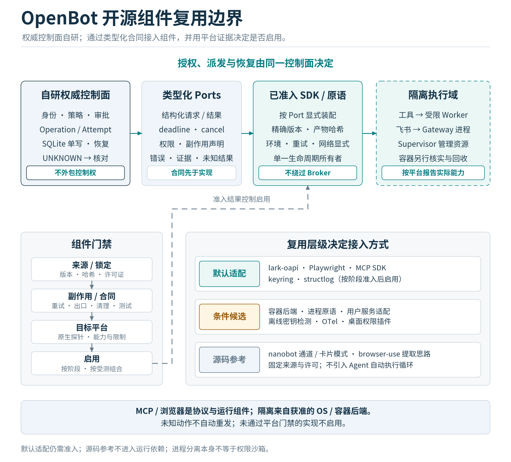

# 开源复用策略与组件准入

## 本轮结论与使用方式

本章把用户新增的U3《OpenBot 开源组件复用评估.pdf》转化为可实施的组件选择。采纳其“自研权威控制面、复用协议与执行原语”的方向；保留v1.1的Task、Operation、Approval、Attempt、UNKNOWN、审批消费、资源隔离和单writer语义。组件清单用于指导实施，不表示这些依赖已经安装、锁定或通过产品测试。

组件选择的事实源是components/catalog.json；本章说明边界，13_component_qualification规定测试，14_revision_v1_2记录对U3的采纳与修订。所有组件的实际准入状态从NOT_RUN开始，精确版本、哈希与许可证证据在实施时填入。官方页面上的latest、报告中的版本范围或GitHub Stars都不能充当发布锁文件。

## 四类复用决策

| 类别 | 含义 | 编码助手的动作 |
|---|---|---|
| DEFAULT_ADAPTER | 当前设计首选，通过薄适配层使用 | 到达所属任务后核对来源、锁定版本、运行准入测试；通过前不能宣称能力可用 |
| GATED_CANDIDATE | 有价值但兼容性或副作用需要先验证 | 先完成小范围PoC，再由ADR和证据决定是否启用；不自动成为默认依赖 |
| REFERENCE_ONLY | 参考算法、接口或交互模式 | 默认不复制代码；若摘取，记录文件、commit、许可证、改动和维护人 |
| DEFERRED / REJECTED_MVP | 延后或当前版本明确不采用 | 不加入MVP默认环境；说明未来重新评估条件 |

这是工程准入规则，不要求用户逐个确认常规库安装。编码助手可以在当前范围内自主核验、锁定、适配和测试；改变信任边界、引入宿主任意执行、云回退或发布行为，仍按用户的具体授权处理。

## 自研范围与默认复用矩阵

| 领域 | 默认复用方向 | OpenBot保留的职责 | 关键验证 |
|---|---|---|---|
| 本地API与SSE | FastAPI、Uvicorn；sse-starlette按需适配 | 认证、Host/Origin、权限范围、序列游标、背压与取消 | loopback、无token泄漏、断线续传、过期游标410 |
| 数据合同 | Pydantic v2、jsonschema Draft 2020-12 | 严格输入、字段权威来源、不可变canonical bytes | 禁多余字段、拒重复键、格式检查、禁远程ref |
| 提案摘要 | Trail of Bits rfc8785与hashlib | 绑定字段、版本、授权、原文存储和复核 | UTF-16排序、数值边界、负零、非法Unicode、官方向量 |
| SQLite | 标准库sqlite3；异步封装可选aiosqlite | 单writer、队列配额、T1至T6事务、迁移、预算和恢复 | FULL/WAL实测、deadline、回滚、备份与产物清单 |
| 模型请求 | 官方openai与ollama SDK或受控httpx；Anthropic后续 | 模型能力、出口、预算、流式重组与唯一重试负责人 | 超时、429、断流、重复计费、无自动工具循环 |
| 飞书 | 官方lark-oapi | 配对、持久去重、审批CAS、Outbox、卡片版本 | 初始化与连接分离计时、外部watchdog、真实回调 |
| 文件ACI | ripgrep；pathspec、unidiff按职责封装 | 句柄守卫、范围、快照、精确补丁、原子提交 | 目录竞态、重名匹配、超限、恶意diff与忽略规则 |
| 语法解析 | tree-sitter及必要语言grammar作为候选 | 有界解析、超时、来源与错误映射 | 大文件、深度、native崩溃、不执行项目配置 |
| 容器后端 | python-on-whales封装一个已验证Docker CLI后端 | 镜像、挂载、网络、资源、产物导出与归属 | 无host兜底；容器ID独立回收；权限与网络实测 |
| 浏览器 | Playwright异步原语与专用Profile | 页面revision、动作审批、网络范围、结果核对 | service worker、重定向、弹窗、frame与UNKNOWN |
| MCP | 官方Python SDK，选择一个完整版本组合 | 工具定义固定、范围、server隔离、事件审查 | 版本协商、stdio环境、list_changed、恶意server |
| 凭据与日志 | keyring、structlog | 后端准入、最小注入、分类、流式脱敏、审计语义 | 无D-Bus/锁定钥匙串、分片秘密、诊断出口 |
| CLI与分发 | Typer、Rich、uv、PyInstaller onedir优先 | 用户流程、安装、资产清单、能力探测 | 无ANSI/HTML注入、原生平台、离线安装资产 |
| Supervisor与桌面 | OS原语及经验证的Rust封装；Tauri后置 | runtime_epoch、drain、归属、用户会话、升级 | 强杀、子孙逃逸、Windows登录会话、UI退出 |

不以“组件成熟”替代本项目的组合验证。组件对输入或子进程的默认行为可能和OpenBot的策略不同；适配器必须把这些差异显式映射到错误、取消和UNKNOWN语义。

## 适配器端口与调用合同

domain只依赖值对象和端口，不导入模型SDK、飞书SDK、Playwright、容器客户端或MCP SDK。application通过端口发起用例；providers、channels、tools与native bridge实现端口。第三方类型不得穿透到Operation、Approval或数据库事务层。

| 端口 | 输入与输出 | 不允许隐含发生的行为 |
|---|---|---|
| ModelTransport | 已过出口策略的请求、deadline、预算上下文；返回流事件与usage | 自行运行工具、云回退、后台联网查价格、无记录的多次请求 |
| Canonicalizer | 已严格解析且满足数值域的JSON；返回canonical bytes | 自动字符串化非法键、丢弃重复键、修改Unicode、忽略非法数值 |
| WorkspaceSearch | 受管snapshot、范围和有界查询；返回带来源的命中 | 任意cwd搜索、继承用户rg配置、把.gitignore当授权边界 |
| PatchParser | 已批准格式的diff；返回内存补丁计划 | 直接写用户路径、模糊套用、执行Git钩子、自动reset |
| IsolationBackend | 镜像digest、输入快照、资源策略与dispatch；返回运行标识和结果 | 拉取latest、挂载HOME/socket、自动联网、失败转host |
| BrowserPrimitive | 已绑定的页面/元素快照与单次动作；返回观察或receipt | 自主规划下一步、在库内请求模型、重复点击未知动作 |
| McpTransport | 已登记server、固定定义与请求；返回协议结果 | 安装包、按annotations扩大权限、继承所有凭据 |
| ProcessSupervisor | 受管进程/容器归属、deadline、stop请求；返回回收证据 | 仅凭父PID退出判定容器结束、把协作清理等同强隔离 |

适配器至少提供capabilities、deadline、cancel、close/cleanup和结构化错误映射。它们的health只表示组件可响应，不表示某次副作用已成功；成功必须来自对应结果与OutcomeVerifier。一个请求只能有一个重试负责人，且attempt计数、预算和审计必须可观察。

## 分阶段依赖与离线资产

依赖按功能分组：dev-contracts、core、provider-openai、provider-ollama、feishu、tools-file、executor-container、browser、mcp、desktop、p2。M0先引入完成当前合同与PoC所需的最小集合；M2/M3依赖在到达对应任务时安装和资格验证。可选模块缺失时返回能力不可用，不让核心导入失败，也不在运行中自动安装。

版本锁覆盖Python包、Rust crates、CLI二进制、浏览器build、tree-sitter grammar、容器image digest、tokenizer数据、前端资产与摘取代码commit。依赖是“包+版本+平台+可选特性+配置+资产”的组合，仅有pip包版本不够。

首次安装或构建阶段可以在明确的联网准备流程中取得资产并校验。OFFLINE启动、模型请求、任务执行和导入测试不下载浏览器、词表、grammar、价格表或远程Schema。离线资产缺失返回明确错误；不要把联网下载隐藏成重试或初始化。成本表保留日期、币种与来源，无法精确统计的token用量明确标为估算。

components/dependency-lock.template.json是填写结构，不是已完成的锁定结果。没有伪造版本、哈希或“已通过”字段；真正实现后由锁文件和产物清单生成记录，并与release manifest互相核对。

## 模型SDK与重试的具体约束

本轮首选官方SDK薄适配器，LiteLLM保留为候选。官方SDK不天然等于零副作用：OpenAI和Anthropic SDK均文档化了内建重试，额外套tenacity可能扩大调用数。[R03][R04] 建议由OpenBot适配器显式配置SDK重试为0，统一管理有界请求重试；若未来委托SDK重试，必须保持单一负责人并逐次观测，不能两层同时重试。

允许重试模型请求并不意味着费用可以忽略。每次请求独立预留和结算；超时或断流的计费状态可能不明，不能立即释放全部预算。半包tool-call不得进入Broker；丢弃的部分输出不等于服务端未计算。OpenAI-compatible只代表协议家族，具体云服务或本机端点需要各自的能力与错误合同测试。

tiktoken作为适用模型的本地预估器，不能声称对所有Provider精确计数。词表离线预置并校验；保留供应商usage作为结算依据。官方SDK同样可能提供自动工具helper，例如Anthropic的tool_runner。适配器仅允许已审查的基础请求API，不调用tool_runner、Agent Runner、自动执行hook，也不启用未经授权的服务端工具。不能仅按“官方/第三方”判断是否存在自动执行。[R03][R04][R05]

Ollama监听loopback不证明所选模型在本机推理；服务支持云功能。LOCAL_MODEL/OFFLINE需同时验证模型来源、服务配置与实际出口，显式关闭云能力，并将模型服务纳入相应网络边界或记录可信的部署证据。不能只拒绝带cloud的模型名后宣称离线；无法确认时禁用本地保证并返回能力不可用。服务更新后重新探测，任务中不拉取新模型。[R05]

## 文件、补丁与解析器的复用边界

ripgrep只承担搜索计算。固定二进制来源、清理RIPGREP_CONFIG_PATH、显式选项与输入根目录；忽略规则用于产品筛选，不能覆盖权限守卫。--max-count通常按文件限制，另需全局命中数、输出字节、时间和文件数量上限。搜索结果重新通过资源范围与快照校验，不能把外部路径原样当作读权限。

unidiff负责解析，patch-ng仅在通过支持子集与精确匹配测试后成为候选应用器。所有文件创建、删除、重命名、行尾、二进制和多文件事务行为由OpenBot合同决定；第三方库能解析某种diff，不代表该操作在产品中已获准。补丁先在受管暂存区计算结果，校验old_sha256后由受控写入流程提交；拒绝路径穿越、模糊匹配、部分成功冒充整体成功。

tree-sitter不执行目标语言程序，但包含native解析代码和grammar，仍可能发生崩溃、资源耗尽或恶意输入问题。采用受限parser worker、文件大小/时间/内存上限和固定grammar集合。当前tree-sitter-language-pack文档包含首次按需下载parser的行为，必须按所选版本核实并在安装期预置，运行期缺失就失败。运行pytest、ruff、mypy、tsc以及项目配置插件仍走隔离执行器。语法树无ERROR不等于功能正确。[R06]

## 容器、MCP与进程归属

先资格验证一个Docker兼容后端。python-on-whales对Podman/nerdctl的支持为best-effort，不能用切换client_call一项参数推导所有挂载、网络、资源和取消语义等价。[R07] Podman、Lima、OrbStack或其他环境逐组合验证；没有对应证据就不列为已支持。bubblewrap保留后续候选，不能作为未经验证的自动兜底。

容器客户端进程和容器不是同一个生命周期对象。Broker登记容器ID、标签和Operation归属；取消后停止并wait，完成受限产物导出和校验，再删除容器。停止客户端不证明容器已停止。导出不得跟随符号链接或接受路径穿越，检查类型、大小、归属和权限；在Windows用ACL语义，不能统一写chmod 0640就宣布安全。[R08]

MCP版本按官方SDK与协议的完整组合锁定，不能把U3的mcp>=1.28当锁定结果。stdio客户端对环境变量的默认处理随版本变化；OpenBot始终显式构造允许列表、受管HOME/TMP/PATH与启动命令，并对实际子进程验证。SDK不承担授权、产物隔离或UNKNOWN恢复；工具完整定义变更后先冻结相关调用，再复审。[R09]

## 飞书、Supervisor与桌面端

复用lark-oapi通信协议与类型，普通卡片作为首个交付能力；CardKit是可选增强，权限或版本不满足时使用已验证的普通卡片路径。nanobot、LangBot仅作为模式参考，摘取代码须走来源台账。社区二维码流程不能替代OpenBot本地owner确认。

飞书SDK冷启动应在Gateway初始化阶段独立测量，随后才开始连接时限；不强制采用线程预热，也不沿用“24.27秒/100%失败”的普遍结论。对于已定位的阻塞发现请求，优先采用经验证的上游修复；必要窄补丁记录commit、差异与退出条件。真正的hard deadline由Gateway之外的supervisor执行，不能只靠可能已被阻塞的同一事件循环。[R10][R11]

command-group已经弃用，当前不纳入默认依赖；process-wrap或processkit按实际保证评估。service-manager可封装支持的launchd/systemd用户级功能；Windows登录用户会话单独设计，不能用sc.exe/WinSW的系统服务能力替代。跨平台Drop/管道/进程组是部分清理机制，必须说明强杀、逃逸、断电和外部容器的剩余边界。[R12][R13][R14]

Tauri与macOS权限插件在M4/P2需要时再引入。权限检查以API结果和真实机器为准，不把“每30天强制重授权”写成固定平台规则；Tauri Capability也不自动为sidecar提供沙箱。

## 凭据、脱敏与观测

keyring需锁定允许后端，验证锁定、无D-Bus、无图形会话与取消场景；不得自动采用不安全替代后端。无可用钥匙串时返回可处理错误；本地加密文件若没有独立主密钥保护设计，不是可直接启用的兜底。[R15]

detect-secrets默认作为开发/CI辅助扫描候选，运行时仅能复用已审查的离线检测器。禁止网络验证、动态插件和外部文本中的allowlist注释改变出口策略；官方工具确实提供联网验证选项，因此必须显式处理。[R16] 固定128字节窗口不能保证所有秘密被识别。流式redactor须定义检测规则、最大长度、编码和flush规则，无法安全判断的缓冲内容不外发；分类阻断、最小注入与已注册secret精确匹配优先于启发式扫描。

structlog提供结构化日志管道，OpenBot负责字段最小化、脱敏顺序、上下文清除和异常格式。OpenTelemetry默认不开启外部exporter；trace、日志、诊断包和模型输入同受出口策略。高基数ID用于有界日志/trace，不直接作为无界metrics标签。

## 许可证、摘取代码与升级维护

本项目默认优先采用适合目标分发方式的宽松许可组件。报告将AGPL/GPL一概称为不可用不准确；本方案把尚未评估的强copyleft代码排除在默认MVP复制和链接路径之外，作为项目准入选择。MPL、双许可证、bootloader例外以及浏览器/grammar/镜像的独立许可都需要按精确文件与分发方式记录，不按“MIT/Apache白名单”一句话省略核验。

直接依赖和摘取源码是两种维护责任。摘取nanobot模板、browser-use DOM逻辑或Aider算法实现时，记录上游URL、commit、文件路径、文件hash、许可证/NOTICE、修改diff、维护人、回归测试、升级触发条件和替换方案；禁止复制完整自治循环。没有足够收益证据时先自行实现有限原语，保持REFERENCE_ONLY。

发布前生成与工具实际输出相符的SBOM：cyclonedx-bom产生CycloneDX，Syft可按配置输出SPDX或CycloneDX；不能混写格式。[R17] SBOM覆盖Python/Rust/前端包、二进制、浏览器、grammar、容器和摘取代码。安全更新改变完整工具定义或执行语义时，应使相应旧授权失效，重新资格验证；不能静默修改已批准Operation的manifest。
