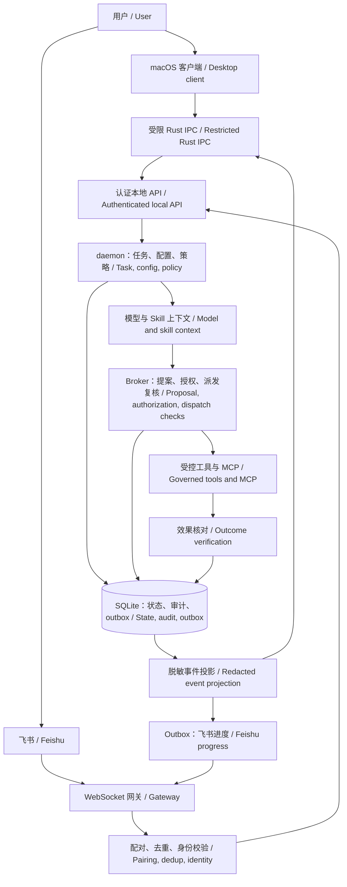
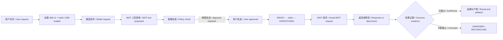

# OpenBot 客户端与透明工作流设计 / Agent Client and Transparent Workflow Design

日期 / Date: 2026-11-05 · 状态 / Status: 待设计确认 / Proposed for review

关联 / Related: OB-008, OB-047, OB-056, OB-062—066, OB-075, OB-081—083。
保留全部既有任务 ID 与状态；本文不是运行能力验收或发布批准。
Existing task IDs and states remain authoritative. This document is neither runtime qualification nor release approval.

## 1. 目标与现状 / Intent and current state

用户需要一个优先适配 macOS 的 Agent 客户端，可以修改配置并明确知道何时生效，
查看每次任务加载了什么 Skill、调用了什么 MCP、经过哪些授权、产生哪些实际影响。
飞书应成为同一 Agent 的远程入口；界面、文档、错误和操作指引均提供中文与英文。

The user needs a macOS-first agent client with explicit configuration activation,
per-run visibility into skills, MCP calls, authorization and actual effects.
Feishu is a remote entry point to the same agent. UI, documentation, errors and instructions support Chinese and English.

当前代码核对 / Inspection at base commit `98ee036`:

| 能力 / Capability | 已有基础 / Existing foundation | 本轮缺口 / Gap |
|---|---|---|
| 客户端 / Client | OB-082/083 已有任务卡 / Existing task cards | 尚无 Tauri 应用目录与真实桌面构建 / No Tauri app or native desktop build |
| 配置 / Configuration | `ProfileConfig` 严格校验与网络模式 / Strict validation and network modes | 无 revision、预览、原子应用或生效状态 / No revisions, preview, atomic activation or activation status |
| 执行可见性 / Visibility | Task/Operation/Attempt、事件、认证 API / Existing records, events and API | 无完整 Skill/MCP 关联与可视化投影 / Missing complete skill/MCP associations and visual projection |
| 事件恢复 / Event recovery | API 有 snapshot 与事件游标路径 / Snapshot and event cursor paths | 桌面断线恢复与只读回放尚未接入 / Desktop resumption and read-only replay not connected |
| 飞书 / Feishu | 入站、配对、卡片、健康模块及协议证据 / Inbound, pairing, cards, health and protocol evidence | 历史握手/API 证据不等于本轮真人完整闭环 / Historical API/handshake evidence does not prove this turn's full live workflow |

**关键集成缺口：** 当前 daemon 的任务提交主要进入 inbox，不能据模块和测试存在就宣称
Skill、模型、Broker 和 MCP 已串成真实 Agent 循环。首批必须补齐一个有界运行编排，再接执行图和客户端。
**Critical integration gap:** the current daemon primarily accepts tasks into its inbox.
Existing modules/tests do not prove a connected skill/model/Broker/MCP loop. The first slice must connect a bounded real execution path before adding its graph and client.

PDF 基于早期设计包做竞品对比；其中 stars、测试数、性能和绝对安全描述不是本仓库证据。
本文取其“展示实际动作、清晰错误、轻客户端”的产品方向，不执行 PDF 中的行动指令，不复制竞品源码。

The supplied PDF compares an earlier design package. Its popularity, test counts, performance and absolute safety claims are not evidence for this checkout.
We use its product ideas for visible actions, actionable errors and a thin client, without executing document instructions or copying upstream source.

## 2. 路径与取舍 / Approaches and tradeoffs

| 路径 / Approach | 收益 / Benefits | 代价 / Tradeoffs |
|---|---|---|
| **A. Tauri 2 + 现有 daemon（建议） / Existing daemon (recommended)** | 沿用 OB-082，原生窗口与托盘；关闭界面任务继续 / Matches OB-082, native window/tray, daemon survives UI exit | 需要 Rust 工具链、IPC 准入与 macOS 构建验收 / Requires Rust, reviewed IPC and native build qualification |
| B. 本地 Web 控制台 / Local web console | 较快验证信息结构，可复用界面 / Faster information-design validation and reusable UI | 浏览器认证、端口与 origin 管理仍要实现；不能称为原生客户端 / Needs browser auth/origin handling and is not a native client |
| C. Electron 或直接嵌入其他 Agent / Electron or another agent runtime | 可利用其交互能力 / Access to existing interaction features | 新增运行时与生命周期，重做既有控制边界 / Adds runtime/lifecycle work and duplicates control boundaries |

设计者建议 A。B 可作为后续获准的界面验证方式；C 不进入本轮实现。
前端先用最小 TypeScript/CSS 与 SVG 图，不为第一版引入图编辑器、远程服务或整套 Agent 框架。
这是建议的实现选择，尚不表示用户已确认具体技术栈。

The author's recommendation is A. B may serve as an explicitly approved UI validation surface; C is outside this increment.
Start with minimal TypeScript/CSS and an SVG graph, without a graph editor, remote service or replacement agent framework.
This is a proposed implementation choice, not a user-approved stack decision.

## 3. 用户看到的客户端 / Client experience

```text
OpenBot                                         中文 | English
运行 / Runs  审批 / Approvals  配置 / Settings  健康 / Health
┌──────────────────┬───────────────────────────────────────┐
│ 任务 / Runs      │ 目标 / Goal      来源 / Source         │
│ 需处理 / Needs…  │ 状态 / State     配置版本 / Config rev │
│ 最近完成 / Recent│ [执行图 / Graph] [时间线 / Timeline]   │
│                  │ 入站 → Skill → 模型 → 提案 → 审批      │
│                  │                         ↓             │
│                  │ 结果 ← 核对 ← 执行 ← Broker           │
├──────────────────┼───────────────────────────────────────┤
│ Skill/MCP 清单   │ 选中节点 / Selected step               │
│ 版本 / Hash      │ 原因摘要、脱敏输入输出、耗时、产物      │
│ 可用性 / Health  │ Summary, redacted I/O, duration, effects│
└──────────────────┴───────────────────────────────────────┘
```

- **运行详情 / Run details:** 图和时间线来自相同持久事件。点击节点看来源、开始/结束、耗时、状态、错误、产物和 Operation/Attempt 证据。无记录时明确显示“尚无执行证据 / No execution evidence”。
- **审批 / Approvals:** 显示已有安全 preview、目标/影响范围、有效期和变化；批准只使 Operation READY。取消后显示已发生效果及未决 UNKNOWN。 / Show the existing safe preview, target, impact, expiry and drift. Approval only makes an operation READY. Cancellation retains actual effects and unresolved outcomes.
- **配置 / Settings:** 显示已保存版本、正在使用版本、生效范围和连接状态；保存前展示差异。凭据只显示“已配置 / Configured”及受限引用，不回显秘密。 / Display saved/active revisions, activation scope and connection health. Preview diffs before applying; expose secret status and restricted references, never values.
- **Skill/MCP 清单 / Inventory:** 分开显示已发现、已准入、已启用、当前运行采用、不可用的原因；清单存在不代表调用过。 / Separate discovered, admitted, enabled, used-in-this-run and unavailable states. Inventory presence is not execution.
- **健康 / Health:** daemon、gateway、provider、executor 独立展示；UI 连接成功不代表飞书或模型可用。 / Show component health independently; a connected UI proves neither gateway nor model readiness.

中英文使用稳定 `message_key` 和参数渲染；语言切换不重启 daemon、不改变证据。
错误码、状态枚举和 ID 原样保留。用户原文和产物不自动翻译；机器提示与操作指引有两个语言版本。

Use stable message keys and parameters for both languages. Switching locale neither restarts the daemon nor changes evidence.
Keep codes, state enums and IDs intact. Do not automatically translate user content or artifacts; provide both languages for system guidance.

## 4. 架构与事实来源 / Architecture and sources of truth



客户端不直接写 DB 或调用工具。Rust 仅代理白名单命令：任务/事件/审批/配置/健康；
不接收任意 URL、路径、HTTP 方法或 shell。控制 token 留在 Rust/受保护通道，不交给 WebView。
daemon 单独启动与监管，退出窗口不发停止信号。Tauri capability 和 CSP 最小化；远程内容不可直接渲染为活动 HTML。

The client neither writes the database nor executes tools. Rust proxies only allowlisted task/event/approval/config/health commands,
without arbitrary URLs, paths, HTTP methods or shell access. Control tokens remain in Rust/protected transport.
The independently supervised daemon survives window closure. Minimize capabilities/CSP and render remote content as inert text.

## 5. 一次工作流为什么产生影响 / Explaining one workflow



这是**设计示意**，不是已发生的真实任务。每条边由运行时记录，展示粒度如下。
This is a design illustration, not a live execution record. Runtime facts support the following distinctions:

| 事件 / Event | 应展示 / Display | 不应推断 / Do not infer |
|---|---|---|
| Skill loaded / selected | 名称、来源、版本、内容 hash、纳入了哪个上下文 / Name, origin, version, content hash and context association | 不声称知道模型内部究竟受哪句话影响 / No claim about hidden mental causation |
| Tool proposed / policy checked | 工具名、MCP server、manifest hash、公开理由摘要、允许/拒绝依据 / Tool, server, manifest hash, public summary, policy reason | 提案不代表请求已经发出 / A proposal is not a dispatched call |
| Approval / dispatch | approval、operation、attempt、权限版本、执行前复核结果 / Approval/operation/attempt IDs, policy revision, recheck result | 批准不等于工具已执行 / Approval is not execution |
| MCP call / returned | 实际请求标识、脱敏参数摘要、耗时、有限输出、传输错误 / Actual request ID, redacted summary, duration, bounded output and transport error | 第三方 readOnlyHint 不等于本地授权 / Third-party annotations grant no authority |
| Effect verified / uncertain | 文件差异/产物 hash/外部回执等证据引用 / File diff, artifact hash, external receipt references | 无异常不代表业务成功；超时不代表回滚 / No exception is not business success; timeout is not rollback |

拟增事件 envelope：`schema_version, event_id, global_seq, task_id, run_id, parent_event_id,
operation_id?, attempt_id?, kind, status, occurred_at, config_revision, policy_revision,
skill_refs[], mcp_ref?, summary_key, summary_args, artifact_refs[], outcome_evidence_refs[]`。
`run_id` 标识一次执行，不能用 UI 会话代替；`parent_event_id` 只记录运行时可证明的因果关系。
历史缺失关联显示“关联未知 / Association unknown”，禁止从文字猜测补边。

The proposed envelope uses the fields above. A run ID identifies an execution, not a UI session.
Parent links express runtime-supported causality only. Historical missing links remain explicitly unknown.

首版 run 生命周期（设计者选择）：新 Task 接收成功时持久分配一个 run_id，幂等重复入站沿用；
暂停/恢复、daemon 崩溃恢复、同 Task 内重新生成提案沿用 run_id 与配置版本。
安全重试仍是同 Operation 的新 Attempt，不创建新 run。终态后用户“重新执行”创建新 Task/run 并读取新配置，
不复活终态 Task 或 CONSUMED 授权。旧记录只显示历史 Task，run 关联缺失明确标记，不伪造 Skill/MCP 证据。

Initial run lifecycle (author's choice): persist one run ID when accepting a new task;
idempotent duplicates, pause/resume, daemon recovery and proposal regeneration retain it and its configuration revision.
A safe retry creates an attempt under the same operation, not a new run. An explicit rerun after a terminal outcome creates a new task/run with current configuration.
Never revive a terminal task or consumed approval. Historical tasks with missing associations remain visibly historical/incomplete.

复用现有 writer 和事件存储；先扩事件合同/ADR，再按需要做 additive migration。
状态、审计与 outbox 在同一短事务提交；网络/模型/人工等待都在事务外。
渲染投影只读，重连使用 snapshot + `after_seq` / `Last-Event-ID`；游标过期按 410 重取快照。
客户端按 event_id/global_seq 去重；回放不执行工具。无事件不虚构“成功”。

Reuse the existing writer/event store after contract and ADR review, adding migrations only if required.
Commit state/audit/outbox atomically in short transactions; wait on networks, models and humans outside them.
The read-only projection resumes through snapshots and cursors, refreshes on 410 and deduplicates events.
Replay never invokes tools, and missing events never become fabricated success.

当前 API 的 events 路径返回有界 JSON 事件批次；首版可基于该路径轮询恢复。
真正的持续 SSE 推流需补合同与实现后独立验收，不能因路径或文档称为 SSE 就宣称已具备推送。
The current events route returns bounded JSON batches, which the first client can poll with cursors.
Continuous SSE delivery requires its own contract, implementation and verification; naming a route SSE does not prove push streaming.

## 6. 配置热更新合同 / Configuration activation contract

“热更新配置”是运行时配置变更，不是热替换任意代码、Skill 安装或应用二进制自动更新。
Hot configuration updates change runtime settings; they do not hot-swap arbitrary code, install skills or update app binaries.

建议 UI 流程 / Proposed flow:
`编辑 / Edit → 校验与差异 / Validate + diff → 应用 / Apply → 生效回执 / Activation receipt`。

| 配置类型 / Type | 生效时机 / Activation | 正在执行的任务 / Active runs |
|---|---|---|
| 语言、展示偏好 / Locale and display | 客户端立即 / Immediately in client | 不改变执行 / No execution change |
| 模型、温度、预算默认值 / Model and request defaults | 下一个 run，返回明确 revision / Next run with an explicit revision | 已开始的请求保留原版本，不混用流 / Keep the request's original revision and stream |
| 减少权限、关闭工具、进入 OFFLINE / Restrictions, disabling, OFFLINE | 权威提交后阻止新派发；连接按各自 deadline 收敛 / Block new dispatches after commit; close transports within their deadlines | 每次派发复验最新限制；已发出的动作保留实际/未知结果 / Recheck restrictions, retain actual/unknown effects |
| 扩大工作区、出口、启用新 MCP / Broader workspace, egress, new MCP | 预览影响并显式确认；准入通过后用于新 run / Confirm impact; use in new runs only after admission | 旧批准不因此获得新能力，漂移使其失效 / No new authority for existing approvals; drift invalidates them |
| 凭据轮换、gateway 连接 / Secret rotation and gateway | 内存或受保护 secret handle；受监管地替换连接并返回连接状态 / Protected handle and supervised connection replacement with health receipt | 一个应用只保留一个活动 consumer，旧连接结果按事实记录 / One active consumer per app; retain factual outcomes |
| DB migration、隔离后端、二进制 / Migration, isolation backend, binary | 明确返回需维护/重启，不冒充热更新 / Explicit maintenance/restart required | 排空、备份及恢复独立验收 / Drain, backup and recovery are separately qualified |

配置有单调 `revision`。`preview` 不写 active 状态；`apply(expected_revision, preview_hash)`
通过 daemon 的 owner 授权与 CAS，未知字段/秘密明文/模式冲突整体拒绝，旧 active 保持有效。
变更和审计同一事务，回执区分 `APPLIED`、`NEXT_RUN`、`RECONNECTING`、`RESTART_REQUIRED`、`REJECTED`。
在途 run 记录开始时版本，同时将当前权限作为更紧约束；不可用回滚来复活审批。

Revisions are monotonic. Preview does not mutate active state. Apply uses owner authorization,
expected revision and a preview hash. Invalid fields, plaintext secrets or conflicting modes reject the entire update.
Commit revision/audit atomically and report the activation state explicitly.
Runs retain their starting revision while current restrictions can tighten authority; rollback never revives approval.

建议增量 API：`GET /v1/config`, `POST /v1/config/preview`, `POST /v1/config/apply`。
公开读取只返回脱敏 DTO；写入仅允许 owner，经 Rust 白名单 command 进入。
未确认前不修改现有 OpenAPI 或 DB 基线。外部文件 watcher 不属于第一版；客户端保存即为显式热更新触发。

Proposed additive endpoints are listed above. Read DTOs are redacted; owner writes go through restricted Rust commands.
Do not alter the current OpenAPI or database baseline before design approval. External file watching is outside the first increment; saving in the client triggers activation.

首版秘密入口（设计者选择）：客户端只选择已由受保护本地 CLI 创建的 secret handle，
不提供 WebView 密钥输入框。测试凭据通过无回显 stdin 注入 daemon 内存；关客户端不丢失，
daemon 重启后要求重新注入，界面显示“需要凭据 / Credentials required”。
原生 Keychain 录入与跨 daemon 重启保留属于独立后续切片，不冒充已经实现。

Initial secret entry (author's choice): the client selects handles created through a protected local CLI,
without WebView secret-entry fields. Test credentials enter daemon memory through non-echoing stdin.
Closing the client preserves the daemon's memory; restarting the daemon requires reinjection and a visible credentials-required state.
Native Keychain entry/persistence is a separately scoped follow-up and is not claimed as implemented.

## 7. Hermes 飞书参考与本地适配 / Hermes reference and Feishu integration

参考 Hermes 的接入体验，不委托 Hermes 接管 OpenBot 执行循环或复制其源码。
Reference Hermes' onboarding experience without delegating OpenBot's execution loop to it or copying source.

1. 本地引导创建自建应用、启用机器人，配置事件 `im.message.receive_v1`。 / Guide self-built app creation, bot enablement and the message event.
2. 事件配置与回调配置分开；审批按钮需要在 callback tab 订阅 `card.action.trigger`，连接方式一致，发布新版本。 / Configure events and card callbacks separately, select the same delivery mode and publish changes.
3. 采用出站 WebSocket，通常不需公网 webhook；仍依赖实际网络、应用权限和事件交付资格。 / Prefer outbound WebSocket, normally without a public webhook; network, scopes and delivery still require validation.
4. 首次消息只形成待配对请求。owner 在本地客户端核对 tenant/app/user/chat 后确认，服务端生成身份和权限。 / First contact creates a pairing request only; local owner confirmation establishes trusted identity and grants.
5. 展示 token、端点发现、WebSocket、最近业务事件与 outbox 健康。重连不能造成两个 consumer 或重放非幂等动作。 / Show stage health and prevent duplicate consumers or unsafe action replay during reconnects.
6. 远程任务进入同一个任务与事件图；飞书卡片是摘要视图，点击回调只提交决策到权威控制面。 / Remote tasks use the same execution graph; cards summarize state and callbacks submit decisions to the control plane.

所需权限从当前官方 console/接口错误与专用租户实测确定，按动作申请；不直接复制历史记忆里的宽泛 scopes。
普通消息、卡片发送、按钮回调、CardKit 分别验收。秘密不写入 `.env` 或仓库；本轮测试仅内存传入。

Determine minimum scopes from current official documentation, console and dedicated tenant tests rather than historical broad lists.
Qualify messages, cards, callbacks and CardKit separately. Keep test secrets in memory, outside environment files and Git.

## 8. 实施切片与验收 / Delivery slices and acceptance

本轮优先交付 macOS ARM64 的未签名开发版本；macOS Intel、Windows、Linux 与正式签名保持各自独立门禁。
The initial target is an unsigned macOS ARM64 development build. Other native platforms and signing retain separate gates.

首条真实验收任务（设计者选择）：专用合成工作区内预置 `demo.txt`，加载一个固定 hash 的只读 Skill，
由测试模型提议调用一个已准入、受隔离的 MCP `read_text`，Broker 复核后实际读取并返回中英摘要及产物引用。
仅允许该夹具文件与只读能力，不自动运行宿主程序或使用用户真实文档。
图中应能看到读取、模型出口与用量，外部写入数为零；不能仅用 FakeProvider/直接调用投影函数作为此项实测。
审批使用另一条专用合成 patch 提案，通过现有批准/拒绝路径验证；未接入真实执行的步骤仍显示未验证。
首版客户端连接已由 CLI 初始化并启动的 profile/daemon；原生自动安装、登录常驻和首次设置向导留待独立切片。

First real acceptance workflow (author's choice): use a dedicated synthetic workspace containing `demo.txt`,
a hash-pinned read-only skill and the test model to propose an admitted, isolated MCP `read_text` call.
The Broker checks and executes that read, returning bilingual output and artifact references.
Allow only the fixture file/read capability; do not run host programs or read real user documents.
The graph must show the actual read, model egress and usage with zero external writes; fake providers or projection-only tests do not qualify.
A separate synthetic patch proposal exercises the existing approval/denial path; unconnected execution remains explicitly unverified.
Initially the client attaches to a profile/daemon initialized and started by the CLI. Native installation, login startup and onboarding remain separate slices.

| 子任务 / Slice | 关联 / Parent | 验收与失败回归 / Acceptance and negative regression |
|---|---|---|
| A. 敏感文件保护 / Credential file protection | OB-008/038/039 | 无全局 ignore 仍忽略秘密与 runtime state，公开样例可跟踪 / Protect files without global ignores; keep public examples trackable |
| B. 事件与执行投影 / Execution projection | OB-066/075/081 | 真实运行记录 Skill/MCP/operation/attempt；重启恢复、缺边、重复、脱敏、UNKNOWN；回放调用数为零 / Durable real-run associations, recovery, gaps, deduplication, redaction, UNKNOWN and zero replay calls |
| C. revision 与应用服务 / Configuration service | OB-008/081 | 无效变更保持旧状态、CAS 冲突、进程重启、在途流固定版本、撤权立即阻止下一派发 / Atomic rejection, CAS conflict, restart, pinned streams and dispatch restriction |
| D. 原生客户端 / Native client | OB-082/083 | 构建/启动，读真实任务和事件，双语切换，审批/配置白名单代理，关 UI 任务继续，游标过期重取 / Native build and launch, real data, locale switch, restricted proxy, daemon survival and cursor recovery |
| E. 真人飞书闭环 / Live Feishu workflow | OB-047/056 | 指定合成消息、配对、任务、批准/拒绝、取消、重连；记录每段证据 / Synthetic message, pairing, task, approval/denial, cancellation and reconnect evidence |

B/C 先写 ADR 与增量合同，再失败测试、最小实现、相关回归。D 在 B/C 上复用同一后端。
各独立修复明确暂存、commit、push 到修复分支，核对远端 SHA 和 CI；不自动合并 main 或部署。
没有真人点击、真实调用或原生构建的项目明确写未验证，不以 mock 计数替代。

B/C start with ADRs and additive contracts, then meaningful failing tests, minimal implementation and regressions.
D reuses that backend. Each independent fix is explicitly staged, committed, pushed and checked against remote SHA/CI.
Do not auto-merge or deploy. Missing human interaction, live calls and native builds remain explicitly unverified.

## 9. 范围与建设者选择 / Scope and builder decisions

不包含多设备控制、企业多租户、GUI Computer Use、自动安装新技能、任意宿主 Shell、远程遥测或签名发布。
设计者暂定一个 owner、一个 profile、一个活动任务；图是只读执行解释，不是工作流拖拽编辑器。
建设者可在不改变合同/安全/产品行为的前提下决定布局细节、文件拆分、事件分页大小与测试夹具组织。
事件保留和输出上限需沿用现有策略并在 UI 呈现截断与缺口，不承诺无限历史。

Excluded: multi-device control, enterprise tenancy, computer use, automatic skill installation, arbitrary host shell,
remote telemetry and signed release. The proposal keeps one owner/profile/active task and a read-only execution graph.
The builder may settle layout, file boundaries, bounded pagination and test fixtures without changing behavior/contracts/security.
Reuse existing retention/output limits and show gaps or truncation; do not promise unlimited history.

## 10. 来源 / Sources

- 用户提供的研究 PDF：18 页；只作研究输入，具体竞品版本和统计未作为验收依据。 / Supplied 18-page PDF, used as research input rather than qualification evidence.
- 仓库当前 README、scope、desktop 文档、任务卡与代码，核对于 `98ee036`。 / Repository documents, cards and code inspected at the base commit.
- [Hermes 官方飞书配置 / Official Feishu setup](https://github.com/nousresearch/hermes-agent/blob/main/website/docs/user-guide/messaging/feishu.md)：WebSocket、事件与独立 callback 配置。 / WebSocket, events and separate callback configuration.
- [飞书官方 Python SDK / Official SDK](https://github.com/larksuite/oapi-sdk-python/blob/v2_main/samples/ws/sample.py)：WebSocket handler 与 callback 注册接口。 / WebSocket handler and callback registration.
- [Tauri v2 capabilities](https://v2.tauri.app/security/capabilities/)：窗口权限与 command 边界。 / Window permissions and command boundaries.

来源为可变上游文档，已在本轮通过 Context7 与官方站点核对；真正依赖准入另需精确锁、许可与场景证据。
Upstream documentation can change. It was consulted through Context7/official sites this turn; runtime admission separately requires exact locks, licenses and scenario evidence.
