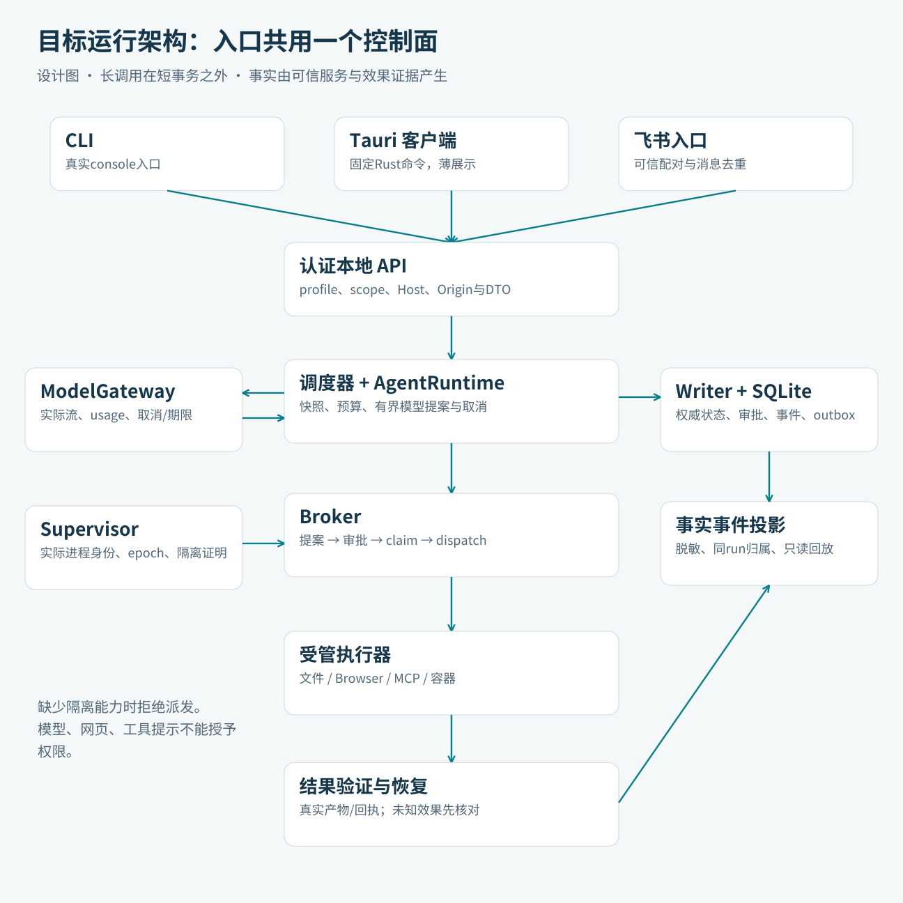
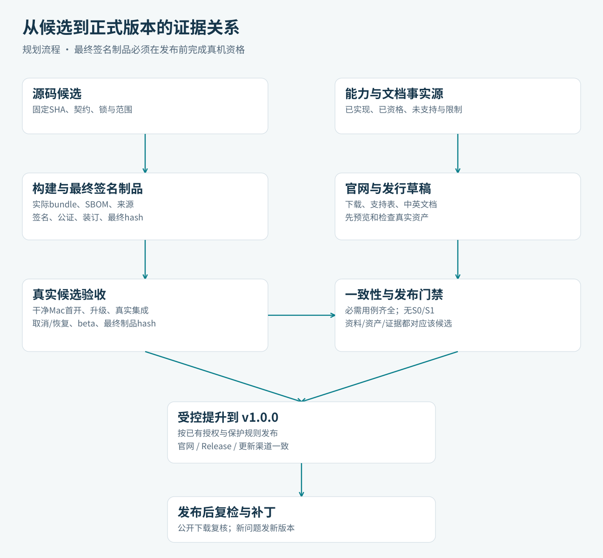
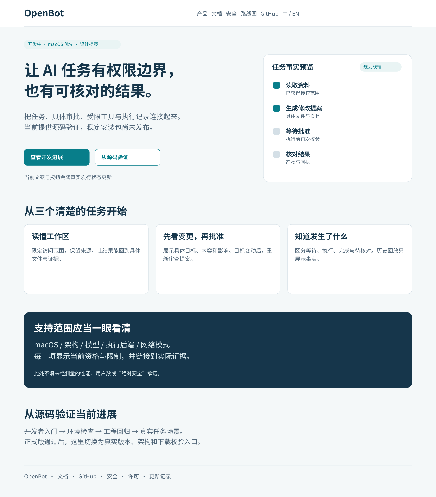
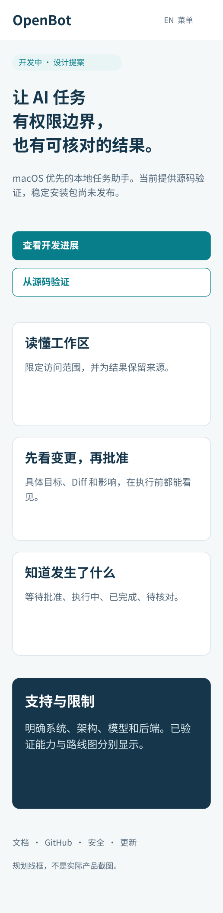
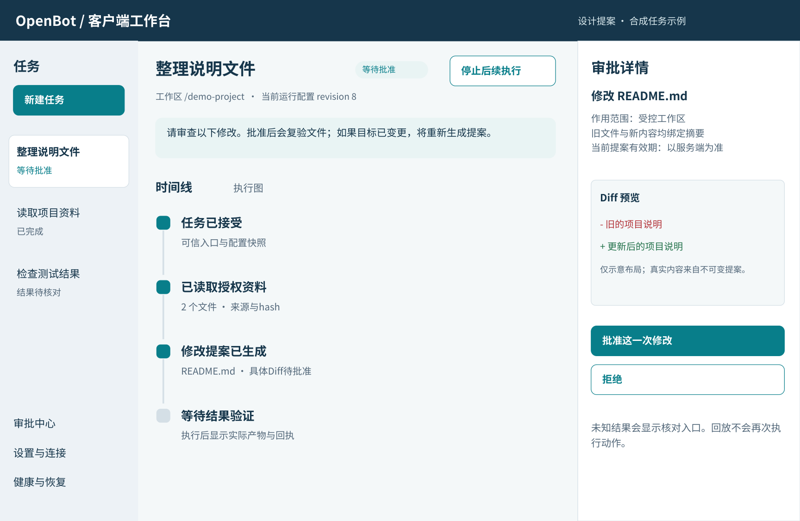

# 设计图与页面线框

所有图均为本方案的目标设计，非已实现客户端截图。向外展示前应使用对应版本的真实产品内容和验收状态。本包提供完整 SVG、PNG 与结构说明，放置在 `plan/v1_0_0/diagrams/` 与 `plan/v1_0_0/website/wireframes/` 下，不覆盖仓库根目录原有的 7 张设计图。

## 运行架构：三类入口共用单一本地控制面

CLI（`openbot daemon serve` / `task create`）、Tauri 薄客户端与飞书长连接入口全部汇聚到同一认证本地 API，由单实例调度器、`AgentRuntime`、持久化 `Writer + SQLite`、`Broker` 与 `OutcomeVerifier` 闭环驱动；任何长耗时网络、模型流与人工审批等待均保持在数据库短事务之外。

## 发布证据关系：候选源码、构建制品与公开声明同源

从源码候选 SHA、依赖锁与能力事实源（`docs/project-status.json`）出发，左侧完成最终签名/公证/SBOM 构建与干净 Mac 真机门禁，右侧生成官网与发行草稿，双方在一致的候选 SHA 与最终制品 SHA-256 门禁（G1–G8）汇合后，才允许受控提升到 `v1.0.0` 稳定渠道。

## 官网桌面首页：诚实阶段标识与任务事实预览

开发阶段首屏明确标注“开发中 · macOS 优先 · 尚无稳定安装包”，主次 CTA 分别指向开发进展与源码验证路径；右侧展示“读取资料 → 生成修改提案 → 等待批准 → 核对结果”的四步事实流，正式版本验收通过后再由 `release_manifest` 驱动开启真实下载入口。

## 官网移动首页：窄屏保持同等限制与状态表达

小屏单列布局（支持 320px 最小视口与 400% 文字缩放）完整保留阶段徽章、双 CTA、三大核心场景与支持边界说明，不使用虚假下载按钮或自动播放大体积视频。

## 客户端工作台：三栏任务、事实时间线与审批详情

左侧展示任务列表与状态筛选，中间呈现当前目标、运行配置 revision 与可切换的事实时间线/只读执行图，右侧展示精确绑定 `binding_hash` 的文件 Diff 审批详情与 `UNKNOWN` 待核对入口；关闭窗口仅断开 UI 连接，不终止后台常驻 daemon。

