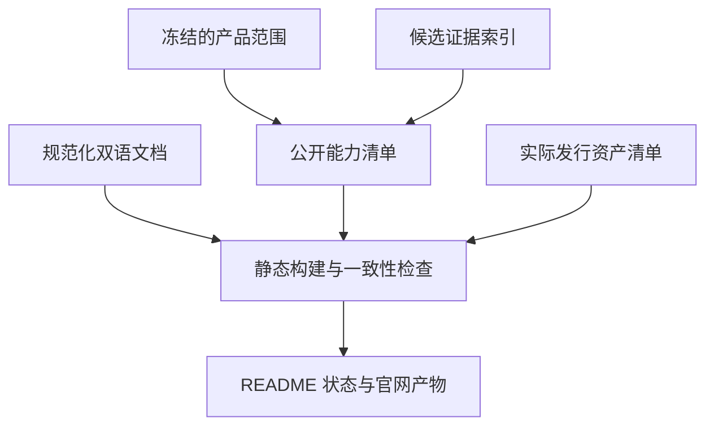

> 历史完整审查：本文固定于2993593a。交付前增量620311b4及最新CI见docs/01_current_state.md、sources R24和source_audit_late_mcp.md；不要把本文旧CI计数当作最新结果。

# OpenBot → v1.0.0：GitHub、文档与官网审查及实施设计

## 1. 结论与审查范围

**下一阶段先建立统一的“真实可用性”说明，再把 GitHub 与官网做成产品入口。** 当前仓库已经有运行时、控制面、验证模块和大量工程材料；活动分支也新增了真正的 ClientState 实现。公开入口仍以设计交接包为主，主分支中英文 README 对完成阶段的描述相互冲突，历史验收报告、任务卡和最新客户端计划又采用不同的状态口径。官网应读取同一份经过审核的能力与版本事实源，避免单独维护另一套“已完成”宣传。

本报告只读审查下列两个固定快照，不执行代码、不修改仓库、不推送、不发布网站。所有新路径、文案和设计均为拟议交付物。仓库 API 元数据是本次读取时的状态，不冒充提交树中的事实。

| 基线 | 固定引用 | 用途 |
|---|---|---|
| 主分支 | `98ee0365a335ed297337c3c0c9aaf9cbf3d5883e` | 当前默认公开入口与已有工程材料 |
| 活动分支 | `2993593a5bd010b85d76a6ca9e279fc4977718dc` | 对照最新客户端设计与 ClientState 基础 |
| 读取日期 | 2026-11-05 UTC | 仓库元数据、关联官网与 Releases 查询 |

入口：[主分支树](https://github.com/xiongcp/OpenBot/tree/98ee0365a335ed297337c3c0c9aaf9cbf3d5883e)、[活动分支树](https://github.com/xiongcp/OpenBot/tree/2993593a5bd010b85d76a6ca9e279fc4977718dc)。

产品 `v1.0.0`、现有应用版本 `0.1.0.dev0`、原设计包 `v1.2`、API/数据库协议版本是不同维度。当前源包版本来自 [pyproject.toml](https://github.com/xiongcp/OpenBot/blob/98ee0365a335ed297337c3c0c9aaf9cbf3d5883e/pyproject.toml)。不能通过把文档标题换成 1.0 来获得稳定发行资格。

## 2. 已存在、缺失与需重写的内容

### 2.1 仓库公开入口对照

| 项目 | 固定快照中核对到的情况 | v1.0 前的处置 |
|---|---|---|
| 主分支中文 README | 标题仍是工程设计与开发交接包；顶部强调 M0–M3 本地落地，后文仍包含设计包初始状态 | 改为当前可用入口，把设计历史移到后半段；每项资格注明证据范围 |
| 主分支英文 README | 仍称没有通过 OB-029、不是 M3 MVP，且缺少生产 claim/dispatch/recovery、控制 API 与端到端 CLI | 与中文以同一候选和事实源同步，不机械翻译过时段落 |
| 活动分支双语 README | 已明确 Agent 编排尚未接通、桌面仍在计划；新增客户端/透明工作流设计入口 | 保留这些诚实边界；减少首屏工程包目录和旧验证数字 |
| 用户文档 | 有 getting-started、troubleshooting、用户 daemon 安装、Feishu 契约 | 分清开发者验证入口、当前可用产品入口和未来设计；真正可执行的步骤逐一验证 |
| 设计与参考文档 | `docs/00`–`14`、ADR、契约、任务卡、演示及 evidence 等材料齐全 | 建文档索引与读者分区，保留历史链接，不一次性搬迁破坏 OB 引用 |
| 安全文档 | SECURITY.md 有四类重要不变量 | 增补支持版本、私密报告入口、处理流程、权限/数据流和已知限制 |
| 贡献与协作入口 | 两树未找到根 CONTRIBUTING、SUPPORT、CODE_OF_CONDUCT、MAINTAINERS、CHANGELOG；未找到 Issue/PR 模板及 CODEOWNERS | 按实际维护方式补齐；不虚构团队、联系地址或响应时限 |
| 项目许可 | 根目录无 LICENSE；项目 SBOM 与 ADR 对项目自身许可有冲突 | 核对有效决定，补齐对应正文和元数据，详见第 3 节 |
| 发行材料 | 有 release 目录、SBOM、校验清单和验收报告；本次 Releases API 返回空数组 | 明确工程证据与真正可下载发行版的区别；下载页只引用真实产物 |
| About / topics | 本次 API 读取 description=null、homepage=null、topics=[] | 准备草稿；等真实关联站点核实后再填写 Homepage |
| 官网关联 | 两个提交树未找到关联官网工程配置/域名；仓库 homepage 为空、has_pages=false | 只能写“未找到关联官网”，不能断言所有外部网站均不存在 |

依据：[主 README](https://github.com/xiongcp/OpenBot/blob/98ee0365a335ed297337c3c0c9aaf9cbf3d5883e/README.md)、[主英文 README](https://github.com/xiongcp/OpenBot/blob/98ee0365a335ed297337c3c0c9aaf9cbf3d5883e/README.en.md)、[活动中文 README](https://github.com/xiongcp/OpenBot/blob/2993593a5bd010b85d76a6ca9e279fc4977718dc/README.md)、[活动英文 README](https://github.com/xiongcp/OpenBot/blob/2993593a5bd010b85d76a6ca9e279fc4977718dc/README.en.md)、[SECURITY.md](https://github.com/xiongcp/OpenBot/blob/98ee0365a335ed297337c3c0c9aaf9cbf3d5883e/SECURITY.md)、[递归主树](https://api.github.com/repos/xiongcp/OpenBot/git/trees/98ee0365a335ed297337c3c0c9aaf9cbf3d5883e?recursive=1)、[递归活动树](https://api.github.com/repos/xiongcp/OpenBot/git/trees/2993593a5bd010b85d76a6ca9e279fc4977718dc?recursive=1)、[仓库元数据](https://api.github.com/repos/xiongcp/OpenBot)、[Releases 查询](https://api.github.com/repos/xiongcp/OpenBot/releases?per_page=10)。

GitHub 官方建议 README 回答项目用途、价值、开始方式、求助和维护信息。这与当前需要从“设计交接”转向“可用性入口”一致。这里不是要求删除架构资料，而是让新用户先找到开始方式。[GitHub README 文档](https://docs.github.com/en/repositories/managing-your-repositorys-settings-and-features/customizing-your-repository/about-readmes)

### 2.2 活动分支已改善之处与尚未接通的边界

活动分支相对主基线有 18 个文件差异：12 个新增、6 个修改。新增内容包括客户端协议/schema、ADR0009、客户端设计与实施计划、证据记录、测试，以及真正的 `services/core/src/openbot/application/client_state.py`。不能再把该分支描述为“只改了文档”。新模块提供配置预览、摘要与 CAS、策略版本关联、运行快照及 trace 等基础。报告中 14 项测试通过属于仓库记录，本轮没有执行，因此不作为本轮实测结果。

另一方面，客户端计划后续所列 `agent_runtime.py`、`stream_transport.py`、`container_read.py`、`client_routes.py`、`apps/desktop` 和 `live_gateway.py` 未出现在该固定树中。ClientState 基础不能直接升级为完整 Agent 工作流、桌面成品或 Feishu 产品闭环。

依据：[ClientState 源码](https://github.com/xiongcp/OpenBot/blob/2993593a5bd010b85d76a6ca9e279fc4977718dc/services/core/src/openbot/application/client_state.py)、[ClientState 证据记录](https://github.com/xiongcp/OpenBot/blob/2993593a5bd010b85d76a6ca9e279fc4977718dc/docs/evidence/client-state.md)、[客户端实施计划](https://github.com/xiongcp/OpenBot/blob/2993593a5bd010b85d76a6ca9e279fc4977718dc/docs/superpowers/plans/2026-11-05-agent-client.md)、[比较入口](https://github.com/xiongcp/OpenBot/compare/98ee0365a335ed297337c3c0c9aaf9cbf3d5883e...2993593a5bd010b85d76a6ca9e279fc4977718dc)。

### 2.3 文档内部最需要消除的矛盾

1. **当前状态与历史状态混排。** AGENTS/CLAUDE 仍把目录描述为仅有设计与 DDL 验证的交接包，并说实现任务默认 TODO；实际 backlog 已有 DONE、VERIFIED、IN_PROGRESS、BLOCKED。应保留原设计的历史状态，新增明确的当前执行入口，不能让 AI 按旧模板重建已有模块。其安全不变量应保留。当前授权是会话范围，不能把本次授权改成永久自动推送许可。[AGENTS](https://github.com/xiongcp/OpenBot/blob/98ee0365a335ed297337c3c0c9aaf9cbf3d5883e/AGENTS.md)、[CLAUDE](https://github.com/xiongcp/OpenBot/blob/98ee0365a335ed297337c3c0c9aaf9cbf3d5883e/CLAUDE.md)
2. **任务状态不能变成产品完成率。** 原 96 项卡片是 DONE 4、VERIFIED 12、IN_PROGRESS 67、BLOCKED 3、TODO 10；OB-082/083 仍 TODO。这个分布表明阶段证据有待统一，不应换算成“已完成百分比”。新客户端计划还有自己的步骤清单，应绑定正式任务与验证证据。[backlog](https://github.com/xiongcp/OpenBot/blob/98ee0365a335ed297337c3c0c9aaf9cbf3d5883e/tasks/backlog.json)、[活动 task_plan](https://github.com/xiongcp/OpenBot/blob/2993593a5bd010b85d76a6ca9e279fc4977718dc/task_plan.md)
3. **用户文档与内部类接口混用。** troubleshooting 中调用 `SecretBroker`、`DatabaseMaintenanceService`、`ObservabilityHub` 的步骤适合开发者，普通用户需要可用 CLI/UI 路径或清楚的开发者标记。不能为了补文档创造实际不存在的命令。[Getting started](https://github.com/xiongcp/OpenBot/blob/98ee0365a335ed297337c3c0c9aaf9cbf3d5883e/docs/getting-started.md)、[Troubleshooting](https://github.com/xiongcp/OpenBot/blob/98ee0365a335ed297337c3c0c9aaf9cbf3d5883e/docs/troubleshooting.md)
4. **外部环境与验收报告缺少统一候选边界。** 外部环境页中已更新的 Feishu 证据与旧英文限制并存；MVP 验收报告还包含旧测试数字和较宽的“通过”表述。应保留原日期、SHA、实际平台和验证层级，不把历史报告自动用于新候选。[环境证据](https://github.com/xiongcp/OpenBot/blob/98ee0365a335ed297337c3c0c9aaf9cbf3d5883e/docs/evidence/external-environments.md)、[验收报告](https://github.com/xiongcp/OpenBot/blob/98ee0365a335ed297337c3c0c9aaf9cbf3d5883e/docs/releases/mvp-acceptance.md)
5. **文档检查仍不足以证明用户路径可用。** 已有测试检查文件、关键字，并用实际 CLI parser 验证少量命令形式；这些很有用，但没有替代干净安装、真实任务、失败恢复和卸载验收。新文档 CI 应保留现有检查，并补候选对应的实际用户路径。[文档测试](https://github.com/xiongcp/OpenBot/blob/98ee0365a335ed297337c3c0c9aaf9cbf3d5883e/tests/unit/test_user_docs_and_security_policy.py)

## 3. 项目许可：补齐既有决定，先解决文档冲突

这里存在三条需要同时看待的事实：

| 证据 | 实际含义 |
|---|---|
| `release/SBOM/spdx-pilot.spdx.json` 将 openbot 的 licenseDeclared 写为 Apache-2.0 | 发行元数据中已经出现项目许可声明，不能忽略 |
| ADR0001 明确写项目自身源码许可尚未由用户选定 | 与上述 SBOM 存在可见冲突，可能是过时 ADR，也可能是过早填入元数据 |
| OB-004 标记 DONE，但验收针对依赖许可证；根目录没有 LICENSE 正文 | 不能用依赖许可验收替代项目源码授权；缺正文需要补齐 |

固定依据：[SBOM](https://github.com/xiongcp/OpenBot/blob/98ee0365a335ed297337c3c0c9aaf9cbf3d5883e/release/SBOM/spdx-pilot.spdx.json)、[ADR0001](https://github.com/xiongcp/OpenBot/blob/98ee0365a335ed297337c3c0c9aaf9cbf3d5883e/docs/adr/0001-scope-baseline.md)、[OB-004 所在任务表](https://github.com/xiongcp/OpenBot/blob/98ee0365a335ed297337c3c0c9aaf9cbf3d5883e/tasks/backlog.json)、[根 THIRD_PARTY_NOTICES](https://github.com/xiongcp/OpenBot/blob/98ee0365a335ed297337c3c0c9aaf9cbf3d5883e/THIRD_PARTY_NOTICES.md)、[发行 THIRD_PARTY_NOTICES](https://github.com/xiongcp/OpenBot/blob/98ee0365a335ed297337c3c0c9aaf9cbf3d5883e/release/THIRD_PARTY_NOTICES.md)。

V1-045 的执行顺序是：查已有明确的维护者/用户决定；若 Apache-2.0 已有效确定，直接按该决定补完整 LICENSE、正确版权信息与必要 NOTICE，更新过时 ADR；只有确实没有有效决定时才单列一次维护者决定。当前规划无需暂停。之后对齐 pyproject、SBOM、README、官网页脚和发行资产中的许可字段。第三方归属单独维护。

GitHub 的 `license=null` 只是本次 API 未识别出许可，不能证明从未作过决定；反过来，单个 SBOM 字段也不足以消除全部冲突。对外暂不制作未经核对的许可徽章或“全部资产开源”声明。项目公开可见与有明确使用许可是两回事。[GitHub 许可说明](https://docs.github.com/en/repositories/managing-your-repositorys-settings-and-features/customizing-your-repository/licensing-a-repository)

## 4. 公开能力事实源设计

建议 V1-040 新增 `docs/project-status.json`、对应 schema 与 `docs/project-status.md`。这是公开摘要，由 V1-001 的范围和 V1-003 的可信证据索引生成。原始运行日志、用户目录、消息内容、Keychain 数据和真实凭据不进入此文件。

每项能力至少有以下字段；字段名为建议，可与主任务的 release manifest 协调后冻结。

| 字段 | 说明 |
|---|---|
| capability_id / title | 稳定能力 ID 与中英文名称 |
| implementation_status | 尚未实现、部分实现、实现已存在；不自动代表验收通过 |
| verification_status / verification_kind | NOT_RUN、BLOCKED、PASS 等结果及合同/集成/原生系统/真实服务层级 |
| code_ref / verified_on_sha | 实现来源与实际验证的不可变版本 |
| platform / architecture / environment | macOS 版本、arm64/x86_64、原生或模拟、外部服务环境 |
| evidence_refs | 指向脱敏证据索引及原始私密证据的受控定位方式 |
| availability_channel | developer / alpha / beta / rc / stable；只有有效门禁可提升 |
| limitations / next_gate | 当前限制及下一道具体门禁 |
| product_version / design_baseline / protocol_versions | 分别记录产品、设计与接口/数据版本 |

**三条轴必须分开：代码存在、验证通过、可对用户提供。** 配置模型已实现但完整 Agent 未接通，是合理的状态；不需要把一个能力简化成绿色或红色。CI 只做合同测试、真实服务缺凭据、平台未实测，都应明确可见。

发布链使用独立的 source commit、产物 build ID / digest、文档站 build ID；不要让一个提交为了写入自己的 SHA 而反复 amend。公开的稳定资格必须能查到最终候选证据，历史记录保留原 SHA。V1-003 负责证据可信性，文档生成器不得把任意手填 PASS 当作升级凭证。



这只是文档数据流。官网不接入本机 daemon，不接收模型密钥，也不参与批准工具执行。

## 5. GitHub About、topics 与视觉入口

### 5.1 当前阶段可以使用的 About 草稿

**英文：**

> Building a local-first assistant with explicit approvals and durable task state. macOS-first; end-to-end agent orchestration is in development.

**中文对照：**

> 正在构建以本地运行、明确审批和持久任务状态为基础的个人助手。优先完善 macOS，端到端 Agent 编排仍在开发中。

这一版与活动 README 的状态一致。不要把尚未合并的 ClientState 功能写成主分支已发布能力。

**只有 v1.0 候选完成相应范围与门禁后，才切换为：**

> A local-first assistant for macOS. Review tool actions, approve execution, and follow task results from your desktop or Feishu.

中文可写：“在 macOS 上运行的个人助手。查看待执行操作、批准执行，并从桌面或飞书跟进任务结果。”这条文案包含桌面与飞书产品入口，只有两条实际路径均通过 V1-001 所冻结的范围门禁才可使用；否则按真实发布范围收窄。原 M3 三平台目标与 macOS 首发支持范围必须分别记录。

### 5.2 Topics 建议

首批候选为 `ai-agent`、`local-first`、`python`、`sqlite`、`human-in-the-loop`、`feishu`、`mcp`、`macos`、`developer-tools`、`workflow-automation`。这些标签表达领域；README 状态矩阵负责说明支持程度。`tauri` 等实现技术应等相关代码真实存在后再加入；不使用 production-ready 或 fully-autonomous 一类暗示资格的标签。

GitHub topics 支持小写、数字和连字符，每项最多 50 字符、每仓最多 20 项。选择少量可准确检索的主题即可。[官方 topics 说明](https://docs.github.com/en/repositories/managing-your-repositorys-settings-and-features/customizing-your-repository/classifying-your-repository-with-topics)

### 5.3 Homepage、徽章与社交预览

- 当前 Homepage 保持空白，直到验证实际域名/站点归属、HTTPS、路由和回退流程。`https://xiongcp.github.io/OpenBot/` 只能作为 GitHub Pages 的候选部署地址，不能说它已经存在。
- CI 徽章写清 `contracts` 或具体检查名称；不能把某个绿色工作流命名为“完整 MVP 已通过”。许可徽章等 V1-045，版本/下载徽章等真实 Releases 和资产门禁。
- 设计一张 1280×640 的不透明社交预览图：OpenBot 名称、简短定位、准确的开发阶段。使用真实界面截图时附候选版本；在客户端可用前可使用清楚标记的流程示意，不做仿真成品截图。
- GitHub 推荐社交预览 1280×640，文件小于 1 MB；社交图应检查手机裁切与浅深背景。[官方社交预览说明](https://docs.github.com/en/repositories/managing-your-repositorys-settings-and-features/customizing-your-repository/customizing-your-repositorys-social-media-preview)

## 6. 中英文 README 首屏草稿

下面是同一状态的两种语言。目标是让新读者在一分钟内知道项目做什么、当前能用到哪里、如何进入开发验证。草稿中的 `docs/project-status.md` 由 V1-040 创建后才可链接；如果 README 先落地，暂用本节状态文字和已有 getting-started，不留下失效链接。

### 6.1 中文首屏

```markdown
# OpenBot

[English](README.en.md) · 开发中 · macOS 优先

在自己的电脑上运行任务助手：查看操作提案、明确批准执行，并保留可追溯的任务状态与结果。

OpenBot 正在把本地运行内核、模型适配器、工具执行与飞书入口接成完整的 Agent 工作流。当前仓库适合参与开发和验证；端到端 Agent 编排与桌面客户端仍在完善，尚未提供正式的 v1.0 下载版本。

## 当前状态

- 已有本地运行与控制面模块，以及安全、恢复和组件验证材料；它们的验证范围见能力状态页。
- 最新开发分支新增了配置与任务追踪的 ClientState 基础；完整运行闭环仍需集成验收。
- 桌面客户端和其他平台支持以各自的候选证据为准，不由 CI 测试数量推定。

[能力与已知限制](docs/project-status.md) · [开发者开始](docs/getting-started.md) · [排障与恢复](docs/troubleshooting.md) · [安全](SECURITY.md)

## 开发者快速验证

按仓库指定的 Python 和 uv 环境准备后执行：

    uv sync --locked
    .venv/bin/python scripts/verify.py

这组命令验证仓库当前测试入口；完整外部服务与原生平台验收另有记录。
```

落地时须把“最新开发分支”替换成准确分支/不可变链接，或待相关变更合并后改成当前版本事实；避免永久使用相对“最新”。主分支尚未包含 ClientState 时不能把这项描述放在“本版本已有”下。

### 6.2 English first screen

```markdown
# OpenBot

[简体中文](README.md) · In development · macOS-first

Run a task assistant on your own computer. Review proposed actions, approve execution, and keep a traceable record of task state and results.

OpenBot is connecting its local runtime, model adapters, tools, and Feishu entry point into a complete agent workflow. This repository is currently intended for development and qualification. End-to-end orchestration and the desktop client are still in progress; an official v1.0 download is not yet available.

## Current status

- Local runtime and control-plane modules exist, together with security, recovery, and component qualification material. Their verified scope is listed on the status page.
- The active development branch adds a ClientState foundation for configuration and task tracing. The complete workflow still needs integration acceptance.
- Desktop and platform support are reported against their own candidate evidence, not inferred from the number of passing CI tests.

[Capabilities and limitations](docs/project-status.md) · [Developer setup](docs/getting-started.md) · [Troubleshooting and recovery](docs/troubleshooting.md) · [Security](SECURITY.md)

## Developer verification

Prepare the Python and uv versions specified by this repository, then run:

    uv sync --locked
    .venv/bin/python scripts/verify.py

These commands exercise the repository's current verification entry point. External services and native platform acceptance have separate evidence.
```

开发命令依据当前 [README](https://github.com/xiongcp/OpenBot/blob/98ee0365a335ed297337c3c0c9aaf9cbf3d5883e/README.md) 和 [verify.py](https://github.com/xiongcp/OpenBot/blob/98ee0365a335ed297337c3c0c9aaf9cbf3d5883e/scripts/verify.py)。这里不创造 `pip install openbot`、安装脚本或未发布下载链接。进入 RC 时，新增经过实际打包验证的普通用户快速开始，并保留源码开发入口。

完整 README 在首屏之后依次放：适用任务及边界、当前支持表、安装/开发、一次受控任务示例、任务恢复与数据流、安全与帮助、贡献与许可、路线图及设计历史。初始的 96 项任务和 52 个组件不再占首屏主位置，仍通过开发文档可查。

## 7. 文档信息架构与重写内容

### 7.1 拟议目录与内容归属

| 内容 | 建议归属 | 维护规则 |
|---|---|---|
| 公开能力矩阵 | `docs/project-status.json` / `.md` | 统一事实源，引用候选证据 |
| 用户手册 | `docs/user/zh/`、`docs/user/en/` | 同一内容集合的双语版本，版本关联明确 |
| 开发指南 | `docs/developer/` | 环境、验证、贡献、架构导航、接口与调试 |
| 当前参考 | `docs/reference/` 或现有 contracts 索引 | 可从实际 schema/CLI 提取的部分自动生成 |
| 原设计与历史证据 | 保留已有 docs/00–14、ADR、evidence 原路径 | 加日期/基线/历史或现行标记；不批量删除或改写原证据 |
| 发行说明 | `CHANGELOG.md` + `docs/releases/` | 按实际发布版本、候选与产物索引，历史不可冒充当前 |
| 官网工程 | 新增 `website/` | 只负责呈现与构建，不复制运行时逻辑 |

官网构建显式读取白名单中的用户文档、事实源和发行摘要。可以在构建时生成 Starlight 内容目录，但生成目录不可与原文同时人工编辑。原始 evidence、执行日志、评审附件不作为整目录拷贝来源。

### 7.2 用户文档最小内容集合

| 页面组 | 必须回答的问题与验收重点 |
|---|---|
| 开始使用 | 当前是源码验证、预览版还是正式安装？支持哪种 Mac/架构？实际入口是什么？第一次受控任务如何完成？ |
| 模型与网络模式 | 云 Provider 与本地 Ollama 如何配置？哪些数据会离开设备？本地地址为何不等于模型必然离线？分别有什么真实证据？ |
| 工作区与权限 | 哪些目录可访问？如何给最小权限？读取、写入、执行、网络与 MCP 的边界在哪里？ |
| 审批 | 批准的是哪组精确参数/内容？过期、撤销、策略变化会怎样？不宣称一次批准永久授权 |
| 任务和结果 | 当前状态、产物、日志摘要、失败原因如何查看？trace 是动作与结果证据，不展示模型私有思维链 |
| 取消与恢复 | 哪些状态可以取消/继续？UNKNOWN 为什么需要核对？如何避免“忽略并重跑”造成重复副作用？ |
| Feishu | 配对、身份、权限、单消费者运行方式、消息与审批回调；实际端到端证据与仅 API 探针分开 |
| 安装/更新/卸载 | 实际产物、校验、平台签名状态、数据位置、备份、迁移失败/回滚、卸载保留/删除数据的区别 |
| 排障与支持 | 错误码、诊断包、敏感数据删除、问题模板；内部 Python 类调用仅归开发文档 |

当前对应材料见 [用户 daemon 安装](https://github.com/xiongcp/OpenBot/blob/98ee0365a335ed297337c3c0c9aaf9cbf3d5883e/docs/install/user-daemon.md)、[Feishu 契约](https://github.com/xiongcp/OpenBot/blob/98ee0365a335ed297337c3c0c9aaf9cbf3d5883e/docs/integrations/feishu-contract.md)、[运行观测](https://github.com/xiongcp/OpenBot/blob/98ee0365a335ed297337c3c0c9aaf9cbf3d5883e/docs/operations/observability.md)。这些是重用基础，不能直接据文档存在宣称每条最终路径已经验收。

### 7.3 开源协作与支持页面

CONTRIBUTING 应写实际分支与验证流程、最小改动、代码审查、逐问题证据和许可要求；AGENTS/CLAUDE 指向同一套有效规则，并保留授权、安全与秘密处理边界。Issue 模板至少分 bug、feature、documentation；bug 表单收产品版本、平台/架构、复现与脱敏结果，明确不得粘贴 token、完整聊天或未经处理诊断包。PR 模板要求问题范围、验证命令、实际结果、相关候选与兼容性说明。

SECURITY 需要真实可用的私密通道、受支持版本和报告处理说明。是否启用 GitHub 私密漏洞报告本轮未核实；启用后才可宣称存在相应入口。不要填假邮箱或没有能力承担的响应 SLA。[GitHub 私密漏洞报告配置](https://docs.github.com/en/code-security/how-tos/report-and-fix-vulnerabilities/configure-vulnerability-reporting/configure-for-a-repository)

## 8. 官网工程与部署设计

### 8.1 推荐方案

推荐 **Astro + Starlight + Pagefind 的静态官网与文档站**。这是一项拟议选型：V1-047 先做简短可复现 PoC，验证中英内容、项目子路径、构建输出和离线搜索，再锁定实际审查过的依赖版本及 lockfile；不能把 `@latest` 留在可重复构建步骤中。

Astro 负责首页和下载/状态页面，Starlight 负责文档布局、语言路由和导航，Pagefind 提供静态本地索引检索。选型的好处是无需为官网新增 Python 服务或公开控制 API，文档与产品运行依赖组保持分离。[Starlight 官方入门](https://starlight.astro.build/getting-started/)、[多语言](https://starlight.astro.build/guides/i18n/)、[站点检索](https://starlight.astro.build/guides/site-search/)

`website/` 维护单独包清单与 lockfile；构建只读取允许公开的文档和资产。网站不接受模型 key、不链接本机 loopback 进行隐式探测、不代理 Provider、不提供审批执行 API、不默认加载第三方统计和字体。代码示例与用户提供文字按文本转义；搜索索引只覆盖本次发行允许公开的页面。

### 8.2 托管、预览与回退

GitHub Pages 可作为候选首发托管，复用现有仓库维护习惯；如采用项目站，必须验证 `/OpenBot/` base 路径以及中文深链接、404、图片和搜索索引。自定义域名、DNS、域名所有权及证书单独确认，不默认占用或购买。Pages 是静态托管，官方也说明会为安全目的记录访问者 IP；因此“我们未启用站点分析”可以成立，“完全不收集任何访问数据”不能未经核对写出。[GitHub Pages](https://docs.github.com/en/pages/getting-started-with-github-pages/what-is-github-pages)、[Astro 的 GitHub 部署](https://docs.astro.build/en/guides/deploy/github/)

PR 生成可审核的静态产物或隔离预览；预览不索引、不带真实凭据。正式部署使用已通过门禁的同一个构建产物，保存 build ID、source SHA、内容摘要和上一版本；回退恢复上一已核验产物，不在事故时重新安装浮动依赖构建“同名版本”。V1-054 只建立这些能力与回退演练，实际生产发布还必须满足 V1-055 和执行当次的发布授权。

本轮仅提交设计与任务，不部署 Pages、不更改 About、不上传社交图、不修改 DNS。

## 9. 官网页面与内容设计

### 9.1 信息架构

所有路径为拟议相对路由；真实域名/项目 base 由 V1-047 冻结。

| 路由 | 页面目标 | 关键内容与行动入口 |
|---|---|---|
| `/` | 清晰的语言入口或确定默认语言 | 中文 / English；不强制无法退出的地理跳转 |
| `/zh/`、`/en/` | 解释产品用途与当前阶段 | 首屏定位、可用性提示、真实演示、开始使用、GitHub |
| `/{lang}/docs/start/` | 完成第一次真实使用 | 当前渠道、支持矩阵、前提、实际步骤、预期结果、排障 |
| `/{lang}/docs/` | 按任务检索用户文档 | 开始、模型、权限、审批、Feishu、恢复、更新/卸载 |
| `/{lang}/download/` | 找到适合自己环境的真实产物 | 平台/架构/最低系统、版本、hash、签名、公证、安装与回退 |
| `/{lang}/releases/` | 查看版本变化 | 真实版本、发布日期、迁移、修复、限制、候选/产物关联 |
| `/{lang}/status/` | 审核可用性声明 | 实现/验证/渠道分轴矩阵、证据摘要、未通过项 |
| `/{lang}/security/` | 理解权限、数据流和报告问题 | 网络边界、云与本地模型、诊断数据、报告通道、支持版本 |
| `/{lang}/contribute/` | 合适地参与项目 | 开发路径、贡献规则、任务入口、支持和许可 |

导航建议最多五个主入口：开始、文档、下载、版本与状态、GitHub；语言切换固定可见。安全与贡献放页脚，并在首页的权限说明中显著连接。未发布下载时，下载页明确说明当前阶段并引导源码验证，不展示无效系统按钮。

### 9.2 首页内容顺序

1. **首屏：一句用途、准确阶段、一主一辅入口。** 当前阶段主按钮“查看开发者指南”，辅按钮“GitHub”；稳定版资格通过后再变为“下载 macOS 版”和“阅读文档”。
2. **一个完整产品故事。** 用户提出任务 → 查看动作/参数与可能影响 → 明确批准 → 查看执行状态与结果 → 失败或 UNKNOWN 时按证据恢复。每一帧来自实际候选；开发设计稿必须标“设计示意”。
3. **三个具体能力主题。** 可控操作、持续任务状态、可追溯结果。不要用“全自动”“永不出错”“绝对安全”或没有基准的性能承诺。
4. **当前支持边界。** Mac 架构、云/本地模型、Feishu、桌面和工具路径按统一事实源显示；尚未实现仍可列在路线图，但不与现有功能混排。
5. **数据与权限。** 哪些内容留在设备，哪些会发给选定服务；用户在哪里决定权限，如何撤销或停止。
6. **开始与参与。** 对应真实安装/开发路径、问题支持、许可和贡献。

不要在首页放 96 个任务、全部协议名和所有组件徽标；这些属于文档索引。产品的可信性来自明确的状态与实际结果，不来自徽章数量。

### 9.3 下载页与发行联动

下载页直接消费发行流水线生成并核验的 manifest，不在网页源代码手写 URL。每项至少包含产品版本、channel、来源 SHA、产物摘要、文件大小、OS/架构、最低系统、签名/公证状态、安装说明、已知限制和迁移/回退链接。构建/时间等字段由流水线提供，不虚构。

以下反例必须拒绝生成稳定下载：资产缺失；摘要与实际文件不符；同名产物属于另一候选；把未签名预览展示成已签名稳定版；只有合同测试而缺所声明平台/真实服务证据；把设计包 PDF 当可运行软件包。V1-031 负责产物，V1-050 负责网站准确消费。

### 9.4 真实演示的内容边界

V1-052 等 V1-024/026 客户端路径实际具备后录制：一条成功受控任务、一条拒绝或取消、一条故障/UNKNOWN 恢复。选用无私密数据的固定 demo workspace 和受控外部接收器；保留原始证据，公开版只含必要脱敏摘要。截图必须记录候选、系统、日期和场景，不能拿旧界面配新功能说明。Agent 过程展示工具、状态、审批与结果，不把内部推理文本作为透明度功能。

## 10. 视觉与交互规格

以下是设计目标，尚未生成或验收成品页面。

| 维度 | 建议规格 | 验收方式 |
|---|---|---|
| 气质 | 简洁、清楚、可信；以任务界面和结果为主视觉 | 首屏读者可说出用途、当前阶段、下一步 |
| 颜色 | 浅底 `#F7F8FA`，主文字 `#152B3C`，主操作 `#0F766E`，提醒 `#92400E`，错误 `#B42318`，分隔 `#D9E2EA` | 每种实际前景/背景组合重新测对比，不按色号宣称已满足 AA |
| 字体 | 系统中文/拉丁字体栈，正文字号 16–18 px、行高约 1.6 | macOS Safari 与 Windows/Linux 阅读抽查；不加载第三方字体 |
| 宽度 | 官网内容约 1120 px，文档正文约 72ch | 320/375/768/1280 宽度不裁切；代码块可单独横向滚动 |
| 层级 | 桌面主标题 48–64 px，手机 32–40 px；一页只有一个视觉主操作 | 移动首屏看到阶段说明和主入口 |
| 状态 | 标签 + 图标 + 简洁解释 | 不仅凭红绿颜色；键盘和读屏可理解 |
| 动效 | 默认克制，尊重 reduced-motion；演示视频由用户触发 | 不自动播放、无闪烁、无滚动劫持 |
| 图片 | 真实截图可放大，关键动作加文字说明 | 清晰候选归属与 alt；模拟图显式标注 |
| 搜索 | 本地静态索引，按语言检索，结果显示版本/路径 | 中文英文各至少 10 个代表查询可找到正确当前页面 |

### 10.1 内容与可访问性门禁

以 WCAG 2.2 AA 为设计和验收目标，结合自动化与人工检查；仅靠自动工具不能声称已经完整符合标准。[WCAG 2.2](https://www.w3.org/TR/WCAG22/)

具体检查包括键盘全流程、可见焦点、跳过导航、正确标题层级、表单标签、图片替代文本、VoiceOver 阅读顺序、400% 缩放和 320 CSS px 回流、深浅主题对比、关闭动画以及下载链接的可理解名称。每条关键路径在 Safari 与 Chromium 的声明版本抽查，目标无严重/致命自动可访问性问题，人工问题逐项闭环。

### 10.2 性能预算与工程门禁

以下数值是拟议预算，不是当前网站测量结果；V1-047 可在 PoC 后记录理由调整，并在正式验收前冻结：

- 首页首屏压缩 JavaScript 不超过 120 KB，不把用户点击后加载的搜索/视频混入首屏；CSS 不超过 60 KB。
- 首页主视觉单图不超过 250 KB，优先用无需大资源的实际界面裁图；不为装饰引入视频背景。
- 固定测试设备、网络与浏览器版本进行三次 Lighthouse 性能检查，以中位数 ≥90 为初始预算；不能把该合成分数当作真实用户统计。
- 内部链接、锚点、资源和语言映射零错误；外链校验分清真实 404 与执行环境网络限制。
- 禁用 JavaScript 后主要介绍、文档正文、可用性提示和下载信息仍可读。
- 向公开导出输入加入敏感 canary、真实 token 形状和私密路径时必须阻止泄露；不能仅依赖一句“请勿上传秘密”。
- 站点构建成功不能覆盖产品门禁失败；下载身份/摘要、许可、稳定资格、私密数据任一失败都阻止相应公开发布。

## 11. 文案可以何时升级

| 对象 | 现在可写 | 需要证据后才能写 |
|---|---|---|
| 完成度 | 开发中；已有运行与控制面模块，完整 Agent 仍在集成 | 端到端工作流已完成、可稳定日用 |
| ClientState | 活动分支新增配置与追踪基础，仓库记录有对应测试 | 已发布完整桌面配置与任务跟踪产品 |
| 平台 | macOS 优先；具体通过范围见状态页 | 支持 macOS/Windows/Linux 全平台及对应架构 |
| 模型 | 设计/适配支持云与本地模型路径，分别验证 | 云 Provider 与真实 Ollama 均满足冻结范围；localhost 自动等同离线仍不可写 |
| Feishu | 已有契约/适配与部分真实探针证据 | 真实消息→任务→审批→执行→结果完整通过 |
| 安全 | 明确审批、最小权限、持久状态与隔离是设计边界 | “绝对安全”“不会泄密”等无条件保证仍不可写 |
| 隐私 | 默认无站点分析；产品数据流按选定模型与服务说明 | “所有数据永不离开设备”只在严格满足相应模式且限定范围时描述 |
| 开源许可 | 项目许可记录正在统一；公开仓库可查看 | 明确许可证徽章、软件和资产许可范围，需 V1-045 对齐 |
| 下载 | 当前尚无本次查询可见的正式 Releases | 有实际产物、校验、平台资格和安装/升级证据后展示对应 channel |

完整 macOS MVP 仍依照已冻结的 M3 功能范围，云 Provider 与真实 Ollama 是两条独立必需路径；只验证其中一条时应准确称收窄试点。Tauri/M4 不倒推为原 CLI/daemon MVP 必需条件；若 v1.0 新范围明确包含桌面客户端，则桌面成为该次 v1.0 自己的门禁。对外声明以 V1-001 冻结的发布范围与真实证据为准，不因当前代码缺失而悄悄删除原要求。

## 12. 可直接排期的 16 项任务

完整字段、实施步骤、负例与具体验收位于同目录 `docs_web_tasks.json`。所有任务状态为 **PLANNED**，不把审查或设计当作完成实现。规模 S/M/L 是相对规模，不是工时承诺。此处仅列最小概要。

| ID | 阶段 | 优先级 | 主题 | 依赖 |
|---|---|---|---|---|
| V1-040 | alpha | P0 | 公开能力事实源与状态矩阵 | V1-001、003 |
| V1-041 | alpha | P0 | 中英 README 一致首屏与真实入口 | V1-040 |
| V1-042 | alpha | P1 | About、topics 与社交预览 | V1-040、041 |
| V1-043 | alpha | P0 | 文档 IA、当前 quickstart、恢复指南 | V1-001、003、040 |
| V1-044 | alpha | P1 | 贡献、支持、Issue/PR 模板 | V1-001、040 |
| V1-045 | alpha | P0 | 许可决定核对、LICENSE/NOTICE | V1-001 |
| V1-046 | alpha | P0 | AGENTS/CLAUDE 与历史状态整理 | V1-001、040、045 |
| V1-047 | beta | P1 | 官网栈 PoC 与静态站骨架 | V1-040、043 |
| V1-048 | beta | P1 | 首页与产品故事 | V1-040、041、047 |
| V1-049 | beta | P1 | 双语文档、搜索、版本导航 | V1-043、047 |
| V1-050 | rc | P0 | 下载页消费真实发行清单 | V1-003、031、040、045、047 |
| V1-051 | beta | P0 | 安全/隐私、漏洞通道、支持矩阵 | V1-001、003、040、044、045、047 |
| V1-052 | beta | P1 | 实际候选截图与受控演示 | V1-003、024、026、048 |
| V1-053 | rc | P1 | 可访问性、移动、性能验收 | V1-048、049、050、051、052 |
| V1-054 | rc | P1 | SEO、预览、部署与回退能力 | V1-047、053 |
| V1-055 | rc | P0 | 文档/版本/链接/发行声明一致性门禁 | V1-040、041、043、044、045、046、049、050、051、054 |

阶段分布为 alpha 7、beta 5、rc 4。外部依赖只引用总计划的范围、证据、客户端与打包任务；其余为本组依赖。V1-043 的 alpha 完成条件是当前实际开发入口和恢复说明，不要求尚未生成的稳定安装包；V1-055 再对最终 RC 的干净 Mac 安装和完整用户路径验证。V1-054 建立发布流程不等于执行生产发布，避免与最终门禁形成语义循环。

### 建议执行顺序

先并行完成事实源、许可核对与文档基础；主分支和活动分支的现状分别记录，不在报告中假定后者已合并。随后重写两种语言和协作入口，修正 AGENTS 的过时事实。核心工作流仍在开发时可以建设静态官网与文档，页面保持准确的开发状态。真实客户端具备后录制候选演示，打包完成后接下载页。最后执行文档、网站、产物身份和平台支持的一致性检查，再更新公开 stable/1.0 声明。

## 13. v1.0 公示的最终条件

发布前必须能针对最终候选回答：新用户按公开说明能否安装并完成一条受控任务；权限、批准、执行结果和 UNKNOWN 恢复是否与说明一致；所宣称的模型、Feishu、桌面和平台路径是否有独立证据；下载文件是否就是验证过的产物；许可、版本、变更记录和已知限制是否一致。缺少某项不通过隐藏页面或改成绿色徽章处理，应该保留明确状态并按冻结范围决定是否阻断发行。

稳定版本还需要写明承诺保持兼容的公共接口，例如用户配置格式、CLI/API 使用面和存储升级策略。Semantic Versioning 把 1.0.0 与公开 API 的定义联系起来，不能只有版本号没有兼容性边界。[SemVer 官方规范](https://semver.org/)

本轮交付的是可执行审查与任务设计。未修改 GitHub 元数据，未添加 LICENSE，未执行新增测试，未上传网站，也未将任何计划项标记为实现完成。
